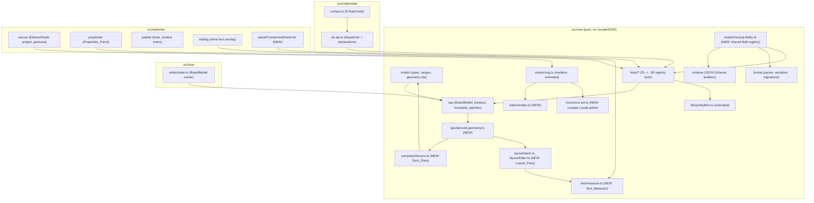
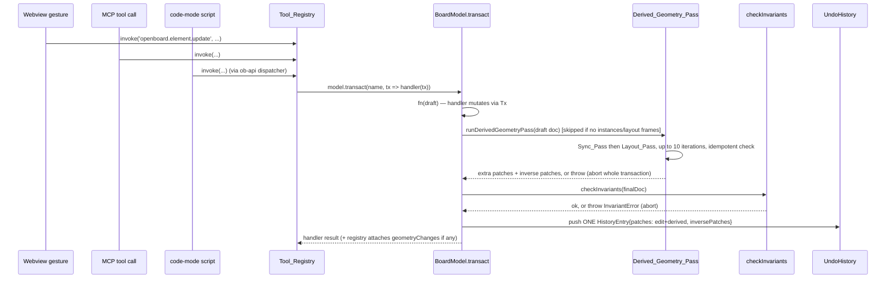
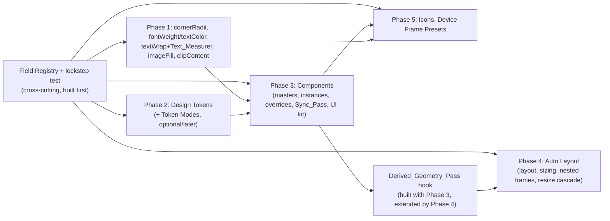

# Design Document

## Overview

OpenBoard's mockup features add screen-design capability to the existing whiteboard/flowchart core without a separate "mockup mode." Every new capability is an **optional** field on the existing `Element`/`BoardDocument` model (Req 1). The design therefore has one overriding constraint that shapes every decision below: a document that uses none of the new fields must produce byte-identical serialized output and pixel-identical rendering to the pre-feature build (Req 1.2, 1.3, 2.9).

The codebase already separates concerns cleanly along lines this feature reuses:

- `src/core/model` — plain data types (`Element`, `BoardDocument`), no behavior.
- `src/core/schema` — JSON Schema builders, compiled at build time by `scripts/build-schemas.mjs` into standalone Ajv validators (`dist/validators.js`), used by the Parser.
- `src/core/format` — `parser.ts` (migrate → validate → `attachExtras`) and `serializer.ts` (`flatten` + `canonicalStringify`).
- `src/core/ops` — `BoardModel.transact`, `Draft`, JSON-patch-like `Patch`/inverse pairs, `checkInvariants`, `UndoHistory`.
- `src/core/export/svg.ts` — the single renderer (`renderElement` switch), used by the Canvas (`ElementNode.tsx` → `renderElementToSvg`) and every export format.
- `src/core/tools` — the 25-tool internal registry (`DefaultToolRegistry`), each tool a plain `{ inputSchema, outputSchema, handler }` running inside `model.transact`.
- `src/codemode/surface.ts` — the fixed five-tool agent surface (`openboard_call` dispatches to the internal registry generically; no per-tool registration code).
- `src/webview` — React/ReactFlow canvas, a data-driven Properties_Panel (`FIELDS`/`fieldsFor`/`commitValue`), palette, editing overlay.

Four places independently decide "what properties exist" today: `src/core/schema/elements.ts` (JSON Schema), `src/core/format/parser.ts` (`attachExtras` known-key lists), `src/core/tools/element-tools.ts` (`normalise`/`passthroughKeys`/`DESCRIPTOR_KEYS`), and `src/core/properties/descriptors.ts` (Properties_Panel). Requirement 4.5 ("a Mockup_Field accepted by one is accepted by all") makes this hand-sync hazard explicit. The design response is in [Field Registry and the Known-Key Lockstep](#field-registry-and-the-known-key-lockstep) below.

A second structural theme: today every write path (webview gesture → `openboard.element.update`, MCP tool call, code-mode script) converges on exactly one place, `BoardModel.transact`, before `checkInvariants` runs. Components (Phase 3) and Auto Layout (Phase 4) both need derived geometry — Instance_Child regeneration and layout arrangement — recomputed after every edit, in the *same* undo entry. Because all three client surfaces already share `transact`, inserting one `Derived_Geometry_Pass` hook there (see [Derived_Geometry_Pass](#derived_geometry_pass)) satisfies Req 18.4 ("webview, MCP, code-mode... all three use the same BoardModel transaction") without touching any of the three call sites.

Out of scope, per the requirements Introduction: component variants, layout constraints/responsive resizing, boolean ops/vector editing, prototyping/click-through, importing other design tools' files, the full Lucide set, and live cross-board component sync.

### Assumptions and Open Decisions (summary)

These are called out again inline where they arise; collected here for visibility:

1. **Text_Measurer uses one approximate, synthetic glyph-width table for all `fontFamily` values** (no per-font metrics, since no DOM/canvas/installed-font access is allowed). This is consistent with the current renderer, which already does not measure real glyphs — it emits `<text>`/`<tspan>` and lets the final rasterizer (browser or headless Chromium) draw glyphs with the real font, but the *line-break positions* are decided ahead of time by the synthetic table. Visual fidelity (Req 5.3) is therefore bounded by how closely the synthetic table approximates common UI fonts, not by DOM measurement.
2. **A Token_Reference is recognized by the literal string prefix `token:`** in a color field or `fontFamily`. A user-typed literal value that happens to start with `token:` is indistinguishable from a reference. This mirrors the existing `theme:default` sentinel convention already used for `Color`.
3. **The known-key lockstep is enforced by a dedicated cross-module test plus partial constant-sharing**, not a single generated-code source of truth, because the four modules use structurally different representations (JSON Schema objects vs. flat key arrays vs. descriptor records) and a full unification is a larger refactor than this feature warrants.
4. **The `openboard_call` surface-size budget (`surfaceSize(surface) < 4096`, description `< 600` chars) is at risk** once ~10 new short action names are added to its enum/description. The design removes the inline action-name listing from the description (pointing to the `actions` skill topic instead) to keep headroom; if that is insufficient, Req 25.8 explicitly permits raising the budget via an explicit change to the asserting test.
5. **The webview has no localization mechanism today** (`vscode.l10n.t` is Extension-Host-only; no webview code calls it). Satisfying Req 26.4 for new strings requires introducing one. The design adopts the `@vscode/l10n` npm package's standalone runtime inside the webview bundle, reading the same `l10n/bundle.l10n.json`.
6. **SVG nested `<clipPath>` composition** (a `<clipPath>` element itself carrying a `clip-path` attribute referencing another) is used to intersect nested `clipContent` regions, per the SVG 1.1/2 specification. All raster export paths (PNG/JPEG/WebP/PDF) go through browser/headless-Chromium rasterization of this same SVG (`src/webview/export/rasterizer.ts`, `pdf.ts` wraps an already-rasterized image) and are expected to honor it; this is flagged as a point to verify empirically in the reference environment during implementation.


## Architecture

### Layering (unchanged shape, new modules added in place)



Every new module is pure TypeScript with no `vscode` or DOM import, matching the existing `src/core` discipline, so it stays usable from the Extension Host, the webview bundle, and the code-mode QuickJS sandbox unchanged (Req 28.8 depends on exactly this).

### Data flow: one edit, three client surfaces, one pass



Because the pass runs *inside* `transact`, after `fn(draft)` and before `checkInvariants`, and because its patches are concatenated onto the edit's own patches before the single `history.push`, Undo/Redo need no changes: `UndoHistory.undo`/`redo` already just replay `inversePatches`/`patches` through `model.apply`, which never invokes the pass again (Req 18.12, 18.13).

### Phase delivery order and dependencies

The five phases from the requirements map to implementation order, each buildable and testable independently because later phases only *add* optional fields:



Rationale: Tokens (P2) must exist before the built-in UI kit (P3) can define its colors by reference (Req 16.7). `clipContent`/`cornerRadii` (P1) are needed by Device_Frame_Presets (P5). The `Derived_Geometry_Pass` hook is introduced with Phase 3 (for Sync_Pass) and only *extended* with the Layout_Pass call in Phase 4 — the hook's shape (iterate-until-stable, cap at 10, same-undo-entry, idempotent) does not change between the two phases, so no rework is needed, only an added pass function in the loop.


## Components and Interfaces

### Field Registry and the Known-Key Lockstep

**Problem** (confirmed by reading the code): `parser.ts` has `STYLE_KEYS`/`BASE_KEYS`/`TEXT_KEYS`/`TYPE_KEYS`; `element-tools.ts` has its own `STYLE_KEYS`/`DESCRIPTOR_KEYS`/`passthroughKeys`; `schema/elements.ts` has `styleSchema`/`baseProps`/`textProps`/`extraProps`; `properties/descriptors.ts` has `PROPERTY_DESCRIPTORS`. These four lists must all agree on every Mockup_Field or Req 4.5 breaks silently (a field accepted by the schema but not in `attachExtras`'s known-key list gets moved into an `extra` bag instead of being treated as known — Req 4.1 would then fail without any test noticing unless something asserts cross-module agreement).

**Design**: add `src/core/model/mockup-fields.ts`, a small, pure, data-only module that is the single place every Mockup_Field's *name and location* is declared:

```ts
export type FieldLocation = 'base' | 'style' | 'type';

export interface MockupFieldSpec {
  readonly name: string;
  readonly location: FieldLocation;
  /** Element types this field applies to; undefined = every type that has `location`'s bag. */
  readonly appliesTo?: readonly ElementType[];
  /** True once this field makes a document require Schema_Version 2 (Req 3.2). */
  readonly schemaV2: boolean;
}

export const MOCKUP_FIELD_SPECS: readonly MockupFieldSpec[] = [
  { name: 'cornerRadii', location: 'style', appliesTo: ['rectangle', 'frame', 'sticky', 'flowNode', 'image'], schemaV2: false },
  { name: 'imageFill', location: 'style', appliesTo: ['rectangle', 'ellipse', 'diamond', 'frame', 'sticky', 'flowNode'], schemaV2: false },
  { name: 'fontWeight', location: 'type', appliesTo: ['text', 'sticky', 'flowNode'], schemaV2: false },
  { name: 'textColor', location: 'type', appliesTo: ['text', 'sticky', 'flowNode'], schemaV2: false },
  { name: 'textWrap', location: 'type', appliesTo: ['text', 'sticky', 'flowNode'], schemaV2: false },
  { name: 'clipContent', location: 'type', appliesTo: ['frame'], schemaV2: false },
  { name: 'layout', location: 'type', appliesTo: ['frame'], schemaV2: true },
  { name: 'sizing', location: 'base', schemaV2: true },
  { name: 'ignoreLayout', location: 'base', schemaV2: true },
  { name: 'component', location: 'type', appliesTo: ['frame'], schemaV2: true },
  { name: 'instanceOf', location: 'type', appliesTo: ['frame'], schemaV2: true },
  { name: 'overrides', location: 'type', appliesTo: ['frame'], schemaV2: true },
  { name: 'name', location: 'type', appliesTo: ['icon'], schemaV2: true }, // icon's own `name` field
] as const;

export function fieldsFor(location: FieldLocation, type?: ElementType): readonly string[];
export function isSchemaV2Field(name: string): boolean;
```

(`frame.name`/`frame.preset` and the pre-existing per-type keys are untouched — this registry lists only the *new* fields.)

Both `parser.ts`'s known-key lists and `element-tools.ts`'s `passthroughKeys`/`DESCRIPTOR_KEYS` are refactored to build their arrays by concatenating their existing hand-written keys with `fieldsFor(location, type)` from this module — a mechanical, low-risk change since both already consume flat `string[]`. `schema/elements.ts` and `properties/descriptors.ts` have structurally different shapes (a JSON-Schema-builder function per type, and a kind/range/enum descriptor record respectively) that are not worth collapsing into the same data shape; instead, a new test, `test/schema/mockup-fields-lockstep.test.ts`, iterates `MOCKUP_FIELD_SPECS` and asserts, for every applicable element type:

1. `buildElementSchemas()[type].properties` contains the field (schema side).
2. `attachExtras` of a raw document carrying the field does **not** put it in that element/style's `extra` bag (parser side).
3. `normalise(type, { [field]: validValue }, ...)` from `element-tools.ts` accepts it, and rejects an out-of-type usage (`unknown_property`) for a type not in `appliesTo` (tool side).
4. If the field has a Properties_Panel control (most do; `instanceOf`/`overrides`/`component`/`layout`/`sizing` are structured fields with their own composite controls rather than a `FieldDef`, see [Webview UI](#webview-ui)), `fieldsFor([...elements])` in `webview/properties/model.ts` includes it for a selection of that type.

This test is the executable form of Req 4.5 and the project's own stated worry about the hand-synced lists; it is intentionally *not* a build-time code generator, since regenerating `element-tools.ts`'s imperative validation branches and `schema/elements.ts`'s builder calls from pure data would be a larger, riskier refactor than this feature's scope, and the four modules differ enough (JSON Schema vs. descriptor record vs. imperative branch) that full unification is deferred.


### Schema Versioning and Migration

`CURRENT_SCHEMA_VERSION` in `src/core/model/ranges.ts` moves from `1` to `2` the moment Phase 2 (Tokens, the first `schemaV2: true` field) ships. In-memory documents are therefore always "Schema_Version 2 shaped" once that phase lands, but Req 3.3 requires the *file on disk* to carry the lowest version that can represent the content. This is a deliberate split between the in-memory constant and the on-disk stamped value:

```ts
// src/core/format/schema-version.ts (NEW)
export function hasSchemaV2Feature(doc: BoardDocument): boolean {
  if (doc.tokens && (hasAnyToken(doc.tokens) || hasAnyTokenReference(doc))) return true;
  return doc.elements.some(
    (el) =>
      el.type === 'icon' ||
      (el.type === 'frame' && (el.component !== undefined || el.instanceOf !== undefined || el.layout !== undefined)) ||
      el.sizing !== undefined ||
      el.ignoreLayout === true,
  );
}

export function effectiveSchemaVersion(doc: BoardDocument): 1 | 2 {
  return hasSchemaV2Feature(doc) ? 2 : 1;
}
```

`serializer.ts`'s `serialize()` calls `effectiveSchemaVersion(doc)` and writes that value for `schemaVersion` instead of echoing `doc.schemaVersion` verbatim (today it just flattens `doc` as-is, which includes whatever `schemaVersion` happens to be stored). This directly implements Req 3.1–3.3, 3.14, 11.14, 13.11, 14.16, 19.12, 23.12 (every "serializer writes Schema_Version 2 when X is present" criterion collapses into this one predicate, each clause of which is a disjunct in `hasSchemaV2Feature`).

Migration: a single identity migration is registered,

```ts
// migrations.ts
export const MIGRATIONS: readonly Migration[] = [{ from: 1, migrate: (doc) => doc }];
```

This satisfies Req 3.5 trivially: every Schema_V2_Feature field is optional, so "fill defaults for absent fields" is a no-op (absence already *is* the default everywhere this design touches). `MigrationRegistry.migrate` already bumps `doc.schemaVersion` to `from + 1` itself (`{ ...m.migrate(doc), schemaVersion: v + 1 }`), so no further change to `migrations.ts` is needed. Req 3.6 (accept a v1 file that already contains a Schema_V2_Feature) also falls out for free: validation and `attachExtras` do not care what `schemaVersion` said, only what fields are present.

Req 3.7 (an *older* build opens a v2 file read-only) is unchanged pre-existing behavior (`MigrationRegistry.migrate` already returns `{ reason: 'newer' }` when `version > target`, and `parser.parse` already opens it read-only with `rawText` retained) — nothing new to build here, only a new fixture-based test confirming it still holds once `CURRENT_SCHEMA_VERSION` is 2 (see [Testing Strategy](#testing-strategy)).

`board.schema.json` (published, build-time generated) gains `schemaVersion: { enum: [1, 2] }` instead of today's open-ended `integer, min 1` (Req 3.9).


### Renderer Changes (`src/core/export/svg.ts`)

The renderer stays a single pure module and the single implementation for Canvas + all exports (Req 5.1); the per-element `Ctx` grows to carry token/theme resolution and the full element tree (for clip nesting), and `renderElement`/`renderToSvg`/`renderElementToSvg` gain parameters with safe defaults so every existing call site (including `ElementNode.tsx`'s `svgFor`) keeps compiling unchanged when a document has no Mockup_Fields.

**cornerRadii.** `rectPath(el, r)` (single radius) is joined by `cornerPath(el, radii)`, which emits one closed `<path>` with an `A` arc per corner that has radius `> 0` and a straight `L` for a `0` corner, matching Req 6.10 exactly. `renderElement`'s `rectangle`/`frame`/`sticky`/`flowNode`/`image`-fallback branches pick `cornerPath` when `el.style.cornerRadii` is present, else keep calling `rectPath` with `el.style.cornerRadius` — so the no-cornerRadii path is textually unchanged (Req 1.3, 6.2).

**Text weight and color.** `renderText` gains two parameters, `weight: number` (the element's resolved `fontWeight`, default `400`) and an already-resolved `color` (today's call sites already pass a resolved color string, so this is additive, not a signature break for the *shape* of the call, only its content): the emitted `<g>` gets `font-weight="{weight}"`; a run with `bold: true` overrides locally with `max(700, weight)` via a per-`<tspan>` `font-weight` attribute (Req 7.2, 7.3). `textColor`, when present, is resolved and passed as `color` instead of the stroke color; `stroke-color` itself (used for the shape outline) is computed separately and is never affected by `textColor` (Req 7.5, 7.12) — this is already how `colorOf(el.style.stroke, ctx)` and `colorOf(el.style.stroke, ctx, 'text')` are two separate calls today, so the change is to swap the *second* call's input from `el.style.stroke` to `el.textColor ?? el.style.stroke` at each of the five call sites (`text`, `sticky`, `flowNode`, `frame` title, edge label untouched).

**Text wrapping.** `renderText` takes an additional `wrap: 'none' | 'wrap'` and `availableWidth: number`. When `wrap === 'wrap'`, instead of `textLines` (today's newline-only splitter), it calls the core `measure()` function (below) on the run-concatenated plain text to get the line-break offsets, then re-slices the original `TextRun[]` at those offsets so per-run `bold`/`italic`/`underline` survive the wrap (a run that straddles a break point is split into two runs with the same style flags). `availableWidth` is `el.width` minus a fixed text padding (the existing `pad` parameter already used for sticky/frame-title/rect text, `4`/`8`/`0`).

**Image fill.** `style.imageFill: { assetId, fit }` on any Fillable_Element. Rendering defines a per-element `<clipPath id="clip-{el.id}">` matching the element's outline (the same arc/corner path used for `cornerRadii`, or an `<ellipse>` for ellipse elements), then renders the fill color rect/shape first, then an `<image>` positioned and scaled per the fit-mode algebra (below), wrapped in `clip-path="url(#clip-{el.id})"` so no pixel escapes the shape (Req 9.2):

- `cover`: `scale = max(width/imgW, height/imgH)`; drawn image size `= (imgW*scale, imgH*scale)`; centered on the element center.
- `contain`: `scale = min(width/imgW, height/imgH)`; same centering; fill color shows in the uncovered margin because it was drawn first.
- `stretch`: drawn image size `= (width, height)` exactly, non-uniform.

If the referenced asset is missing or fails to decode, rendering falls back to "fill color only" and renders every other element normally — mirroring the exact fallback pattern `renderImage` already uses for a missing `image` element's asset (dashed placeholder rect), except `imageFill`'s fallback is silent (just the flat fill, since the element is still a valid shape with its own stroke) per Req 9.9/9.10.

**Frame clipping.** `clipContent: boolean` on `frame`. A clipping Frame emits its own `<clipPath id="clip-{el.id}">` (its own outline). Any descendant of a clipping Frame (computed once per render via a `parentId` index built in `makeCtx`) gets `clip-path="url(#clip-{nearestClippingAncestorId})"` on its own `<g>` wrapper. Nested clipping Frames compose via **SVG's clip-path-on-clip-path**: when a clipping Frame's own nearest clipping ancestor is `A`, its `<clipPath>` definition itself carries `clip-path="url(#clip-{A})"`, so the browser/rasterizer intersects the two regions per the SVG spec, and a doubly-nested descendant only needs one `clip-path` reference (to its nearest clipping ancestor) to inherit the full intersection (Req 10.5). This keeps the existing flat, single-pass `elements.map(renderElement)` loop in `renderToSvg` intact — no tree-recursive restructuring is needed, only an ancestor-clip lookup per element and the extra `<clipPath>` defs collected into the SVG's `<defs>`. Edges are rendered through the same flat loop and are **not** wrapped in any clip (Req 10.6) since `renderEdge` is never a descendant of a Frame in the model (edges have no `parentId` semantics tying them to a Frame).

**Icons.** New `case 'icon'` in `renderElement`: looks up `ICON_PATHS[el.name]` (see [Icon Set](#icon-set)); if absent, uses a fixed placeholder path (a generic "missing glyph" outline) — never throws, per Req 23.6. Output: `<g transform="translate({x} {y}) scale({width/24} {height/24})"><path d="{pathData}" fill="none" stroke="{resolved stroke color}" stroke-width="{strokeWidth}" vector-effect="non-scaling-stroke" stroke-linecap="round" stroke-linejoin="round"/></g>`. `vector-effect="non-scaling-stroke"` (standard SVG/CSS, widely supported by Chromium/WebKit, which back both the webview and the rasterizer) keeps the rendered stroke width equal to `strokeWidth` canvas units regardless of the `scale()` transform, satisfying Req 23.4's "stroke width... unchanged by the Element size" without needing a structured (non-string) path-data format — the raw Lucide `d` attribute strings can be embedded unmodified.

**Token resolution.** `Ctx` gains `tokens: ResolvedTokens` (colors/fonts/numbers maps already resolved to literal values for the active mode, computed once per render call by `resolveTokens(doc.tokens, activeMode)`). `colorOf` and the `fontFamily` read both check for a `token:` prefix first and substitute the resolved literal (falling back to the field's existing default, e.g. `ctx.palette.defaultStroke`, when the token name does not exist — Req 11.9) before the existing hex/`theme:default` logic runs. This keeps `colorOf`'s existing signature and callers unchanged; only its body gains one branch.

**Export option to exclude masters.** `renderToSvg`'s scope-selection step (`selectScope`) is unchanged; a new pre-filter in `export-tools.ts`/`ExportDialog.tsx`, applied *before* calling `selectScope`/`renderToSvg`, removes every element that is a Component_Master, a descendant of one, or an Edge with an endpoint among those removed, when "Exclude component masters" is enabled (Req 17.2) — implemented as a pure filter over `doc.elements`, not a renderer change, keeping the renderer itself agnostic to component semantics.


### Text_Measurer (`src/core/text/measure.ts`, NEW)

Pure, deterministic, no DOM/canvas/font access — required because it must return identical results in the webview bundle, the Extension Host bundle, and the code-mode QuickJS sandbox (Req 8.2, 28.8), none of which can be relied on to share real font metrics (QuickJS has no DOM at all).

```ts
export interface MeasureInput {
  text: string;
  fontFamily: string; // accepted, not used for width (see Assumption 1)
  fontSize: number;
  fontWeight?: number; // default 400; a single element-level weight (Req 8.3's own signature)
  availableWidth: number; // Infinity when textWrap is 'none'
}
export interface MeasureResult {
  lines: string[];
  widestLine: number;
  height: number;
}
export type MeasureOutcome = { ok: true; value: MeasureResult } | { ok: false; error: string };

export function measure(input: MeasureInput): MeasureOutcome;
```

Algorithm:

1. Validate `fontSize` is a finite number `> 0` and `availableWidth` is finite (or `Infinity`); otherwise return `{ ok: false }` (Req 8.13).
2. Split on explicit newlines (`\r\n|\r|\n`) first — these breaks always happen regardless of `availableWidth` (Req 8.1, 8.3, 8.12).
3. For each explicit segment, if `availableWidth` is `Infinity` (no-wrap), keep it as one line. Otherwise greedily word-wrap: tokenize on whitespace runs (keeping a single space width between words on the same line), accumulate `widthOf(token)` using the glyph table below; when the next token would exceed `availableWidth`, start a new line; if a single token alone exceeds `availableWidth`, break it character by character (Req 8.5), and if `availableWidth` is narrower than the widest single character, place exactly one character per line.
4. `widthOf(ch)`: a static table of fractional-em widths for the printable ASCII range (32–126), modeled on typical sans-serif proportional widths (e.g. `'i'`/`'l'` narrow, `'m'`/`'w'` wide, digits uniform), scaled by `fontSize`; any character outside that range (e.g. CJK, emoji) uses a fixed fallback width of `1.0em` — a deliberate simplification (Assumption 1) since it only needs to be *consistent*, not pixel-accurate against a real font, and the renderer never re-flows text itself (the already-decided line strings go straight into one `<text>` per line).
5. `widestLine = max(widthOf(line) for line in lines)`; `height = lines.length * fontSize * 1.2` (same `1.2` line-height constant `renderText` already uses, so unwrapped behavior is bit-for-bit unchanged, Req 1.6).

The editing overlay (`src/webview/editing/EditingLayer.tsx`, `caret.ts`) is changed to call this same `measure()` function (imported from `core/text`, not re-implemented) whenever the edited element has `textWrap === 'wrap'`, rendering the overlay's text as the pre-broken line list (each line an absolutely positioned `<div>`/`<span>` at `y = i * lineHeight`) instead of relying on the browser's native `<textarea>` reflow, and driving the caret (`caret.ts`'s `offsetOf`/`positionAt`) against that same line model, so the overlay breaks at the *same* character positions the Renderer will use for the committed text (Req 8.8). When `textWrap` is absent/`'none'`, the overlay is untouched (today's native textarea flow).


### Design Tokens (`src/core/tokens/`, NEW)

```ts
export interface TokenCollection {
  colors?: Record<string, string>; // name -> literal color (Req 11.3: never a Token_Reference)
  fonts?: Record<string, string>;
  numbers?: Record<string, number>;
}
// BoardDocument gains: tokens?: TokenCollection
```

Token names: `1`–`64` chars, `[A-Za-z0-9._-]`, unique per category by case-sensitive comparison (Req 11.1, 11.2) — enforced in `BoardModel`'s `Tx` surface, not the JSON Schema (uniqueness is a cross-key invariant, which the schema builder's `s.object` cannot express; it is checked in the tool handler and in `checkInvariants` as a defense-in-depth duplicate-name check, mirroring how duplicate element/asset ids are already checked there).

A `Color` value or `fontFamily` string may be a **Token_Reference**: the literal string `` `token:${name}` `` (Assumption 2). `resolveTokens(tokens, mode)` returns flat `Map<string,string>`/`Map<string,string>`/`Map<string,number>` lookups the renderer consumes (see above); a reference to a missing name resolves to `undefined`, and every consumer (renderer, Properties_Panel) treats that identically to "field unset" (Req 11.9) rather than erroring.

New tools (`src/core/tools/token-tools.ts`):

| Tool | Behavior |
|---|---|
| `openboard.token.create` | `{ category, name, value }` → validates name/value per category, rejects duplicates (Req 11.11). |
| `openboard.token.update` | `{ category, name, value }` → applies to the stored literal; every element whose resolved rendering depends on it is implicitly affected next render (no per-element patch needed — tokens are resolved at render time, so "propagation" is free and instant, satisfying the 1-second budget of Req 11.7 trivially because there is nothing to propagate). |
| `openboard.token.rename` | `{ category, oldName, newName }` → rewrites every `token:{oldName}` occurrence (color/fontFamily fields on elements, `overrides`, and Library entries) to `token:{newName}` in the same transaction/Undo entry (Req 11.8). |
| `openboard.token.delete` | `{ category, name }` → rejects with the count of referencing fields if any exist (Req 11.10), else removes it. |
| `openboard.token.list` | Read-only; returns all tokens by category. |

Detach (Properties_Panel-only action, also exposed as a tool for agent parity, `openboard.token.detach` action via `element.update`-style call): replaces a field's `token:{name}` with the resolved literal value (or the field's default if the token is missing), as one Undo entry (Req 11.17) — implemented as a thin wrapper that reads the resolved value and issues a normal `element.update`/override-set with that literal, so it reuses existing update plumbing rather than new patch logic.

Token Modes (Req 12, optional/later) are designed as an additive variant of `colors` values: `string | { light: string; dark: string }`, an `activeMode: 'light' | 'dark' | 'auto'` on `BoardSettings`, and `resolveTokens` picking the right branch (falling back to the IDE theme kind when `auto`, via the existing `ThemeAdapter`). Because it is purely additive to the `TokenCollection` shape and `resolveTokens`'s resolution step, it can be deferred past the rest of Phase 2 without reworking anything built for the single-value case.


### Components, Instances, and the Sync_Pass

**Data model.** `FrameProps` gains three optional fields, all on the Frame element itself (masters and instances are both ordinary Frames on the Canvas, per the requirements' explicit design):

```ts
export interface FrameProps {
  name: string;
  preset?: string;
  // NEW:
  component?: string;        // 1..100 chars, trimmed; presence marks this Frame a Component_Master
  instanceOf?: ElementId;    // id of a Component_Master Frame; presence marks this Frame a Component_Instance
  overrides?: Record<string, Override>;
}
export interface Override {
  text?: string;
  fill?: Color;
  stroke?: Color;
  textColor?: Color;
  fontWeight?: number;
  imageFill?: { assetId: AssetId; fit: 'cover' | 'contain' | 'stretch' };
  icon?: string;
  opacity?: number;
  width?: number;  // only meaningful under the special key `''` (instance root)
  height?: number; // only meaningful under the special key `''`
}
```

`overrides` is keyed by `masterChildId` (the id of the *master's* descendant the override applies to), with the empty string `''` reserved for the instance root's own size override (Req 14.5, 14.17). A Component_Instance frame is never also a Component_Master (`component` and `instanceOf` are mutually exclusive — enforced at create time, Req 13.4).

**Instance_Child ids.** Deterministic: `` `${instanceId}::${masterChildId}` `` (Req 14.2). This means two different Component_Instances of the same master never collide, and re-running the Sync_Pass against unchanged inputs always re-derives the *same* ids for existing Instance_Children — a prerequisite for the idempotence and Edge-stability requirements (Req 15.3, 15.6).

**Sync_Pass** (`src/core/components/sync.ts`, pure function `Element[] -> Element[]`, no I/O):

```ts
export function syncPass(doc: BoardDocument): { doc: BoardDocument; changedIds: ElementId[] };
```

For every Frame with `instanceOf` pointing at an existing Component_Master (directly, or found by walking the whole element list once into a `masterId -> descendants[]` index built up front for O(n) total work):

1. Compute the **expansion**: for each descendant `d` of the master (in master-relative order), the Instance_Child id is `` `${instance.id}::${d.id}` ``; its properties are a shallow merge of `d`'s own properties with `instance.overrides[d.id]` (override wins per-property), and its position is `d`'s position offset by `(instance.x - master.x, instance.y - master.y)` (Req 14.3, 15.2). The instance root's own `width`/`height` is `master.width`/`master.height` unless `overrides['']` sets them (Req 14.17).
2. **Create** any Instance_Child the expansion calls for that the instance currently lacks; **delete** (and cascade-delete attached Edges, reusing the same cascade logic `Draft.remove` already implements) any existing Instance_Child whose `masterChildId` no longer exists on the master; for every Instance_Child that still corresponds to a master descendant, **replace in place at the same array position** (preserving relative stacking order, Req 15.5) with the freshly computed properties — this is a structural `replace` patch per element, identical in shape to `Draft.update`'s existing patch.
3. **Leave every User_Child untouched** (any child of the instance whose id is *not* of the form `${instanceId}::*` matching a current master descendant — Req 14.10, 15.14).
4. **Cycle and depth guard**: before expanding, walk the master-reference chain (`instance.instanceOf -> master -> any instanceOf found among the master's own descendants -> ...`); if a master is revisited (cycle) or the chain exceeds 8 levels, the whole Sync_Pass call throws a typed `ComponentCycleError`/`ComponentDepthError` naming the implicated master ids, which propagates up through `runDerivedGeometryPass` and aborts the *entire* transaction (Req 15.7, 13.13, 14.12, 14.13) — nothing is partially written.

**Idempotence** (Req 15.6, required for `runDerivedGeometryPass`'s iterate-until-stable loop to terminate quickly in the common case): because step 2 always recomputes every Instance_Child from the *current* master+overrides rather than incrementally patching, calling `syncPass` on its own output recomputes the identical expansion and finds zero differences, so it reports zero patches — this is a direct consequence of the expansion being a pure function of `(master, overrides)` with no hidden state.

**Detach** (`openboard.component.instance.detach`): removes `instanceOf` and `overrides` from the Frame; every current Instance_Child keeps its id/properties/parent/position exactly as last synced (Req 15.8) — implemented as a plain `tx.update` clearing the two fields, with no change to any child, since after detach the (former) Instance_Children are just ordinary children the Sync_Pass will no longer touch.

**Create Component** (`openboard.component.create`): two input shapes per Req 13.1/13.2 — a single selected Frame (marked in place), or one-or-more non-Frame Elements (wrapped in a *new* Frame sized to their union bounds with zero padding, which then also becomes children via the existing `adoptChildrenPatches`). Name validation (`1..100` trimmed chars, uniqueness case-sensitive within the document) and the "already an instance" / "already a master" / "mixed selection" rejections (Req 13.3, 13.4, 13.13, 13.14) are plain precondition checks before any mutation, consistent with every other tool's reject-without-mutating pattern.

**Duplicate/paste name collision** (Req 13.9): a small pure helper,

```ts
export function uniqueComponentName(desired: string, existing: ReadonlySet<string>): string;
```

appends `` ` ${n}` `` for the smallest `n >= 2` that is not already taken, truncating `desired` as needed to keep the total at or under 100 chars — used by both the duplicate-element path (`arrange-tools.ts`'s existing duplicate/paste handling, extended to special-case a duplicated Component_Master Frame) and library insertion.

**Instance creation** (`openboard.component.instance.create`): creates the instance Frame with `instanceOf` set and no Instance_Children yet (the just-inserted `tx.create` call), relying on the Derived_Geometry_Pass that runs immediately afterward, in the *same* transaction, to populate Instance_Children via `syncPass` — so the create tool's own handler code never duplicates the expansion logic.

Component panel listing (Req 13.6) is a pure, read-only selector over `doc.elements.filter(e => e.type === 'frame' && e.component !== undefined)`, sorted by name, exposed through `openboard.component.list` and consumed by both the Properties_Panel's component-name control and the new webview Component Panel (see [Webview UI](#webview-ui)).


### Derived_Geometry_Pass

```ts
// src/core/ops/derived-geometry.ts (NEW)
export interface DerivedGeometryResult {
  doc: BoardDocument;
  patches: Patch[];
  inversePatches: Patch[];
  changedIds: ElementId[]; // elements whose geometry/content differs from the pre-pass doc
}
export class DerivedGeometryError extends Error {
  constructor(readonly reason: 'component-cycle' | 'iteration-limit', readonly detail: string[]) { super(...); }
}

export function needsDerivedPass(doc: BoardDocument): boolean {
  return doc.elements.some((e) => e.type === 'frame' && (e.instanceOf !== undefined || e.layout !== undefined));
}

export function runDerivedGeometryPass(doc: BoardDocument): DerivedGeometryResult {
  let cur = doc;
  for (let i = 0; i < 10; i++) {
    const synced = syncPass(cur);       // throws DerivedGeometryError('component-cycle', ...)
    const laid = runLayoutPass(synced.doc);
    if (laid.changedIds.length === 0 && synced.changedIds.length === 0) {
      return { doc: laid.doc, ...diffElements(doc, laid.doc) };
    }
    cur = laid.doc;
  }
  throw new DerivedGeometryError('iteration-limit', [...]);
}
```

`diffElements(before, after)` is a small shared utility (also usable by `syncPass`/`runLayoutPass` internally) that compares two `Element[]` by id and emits `{op:'replace', path:['elements', i], value: after[i]}`/inverse pairs — the same patch shape `Draft.update` already produces, so no new patch-application code is needed in `applyPatches`.

**Hook point in `BoardModel.transact`** (`src/core/ops/model.ts`), inserted between `draft.finish()` and `checkInvariants`:

```ts
const draft = new Draft(this.doc, this.now);
try { result = fn(draft); } finally { draft.close(); }
let { doc, patches, inversePatches } = draft.finish();

this.lastDerivedIds = [];
if (needsDerivedPass(doc)) {
  const dg = runDerivedGeometryPass(doc); // may throw -> propagates out of transact, nothing committed
  doc = dg.doc;
  patches = [...patches, ...dg.patches];
  inversePatches = [...dg.inversePatches, ...inversePatches]; // undo must reverse the pass FIRST, then the edit
  this.lastDerivedIds = dg.changedIds;
}
const problems = checkInvariants(doc);
if (problems.length > 0) throw new InvariantError(problems);
// ...existing commit code, unchanged, using the (possibly pass-extended) doc/patches/inversePatches
```

Because nothing is assigned to `this.doc` or pushed to `this.history` before this point, a thrown `DerivedGeometryError` (or an `InvariantError` from the now-pass-extended document) aborts the whole transaction exactly as a throw from `fn(draft)` already does today — **no new error-handling path is needed in `transact`**, only the insertion of these lines (Req 18.7: content, history, and change notifications are all untouched on failure, because none of the code that produces them has run yet).

`needsDerivedPass` is checked *before* calling `runDerivedGeometryPass`, giving the required fast no-op path (Req 18.8): a document with zero Component_Instances and zero Layout_Frames costs one `.some()` scan (already bounded by the existing invariant-check pass's own full-document scan, so it adds no new order-of-magnitude of work) and zero pass invocations.

**Reporting to tool callers** (Req 18.9–18.11). The handler inside `fn(draft)` already returns its result *before* the pass runs, so it cannot embed pass results itself. Instead, `BoardModel` exposes the last transaction's derived ids:

```ts
// BoardModel
private lastDerivedIds: ElementId[] = [];
takeLastDerivedIds(): ElementId[] { const ids = this.lastDerivedIds; this.lastDerivedIds = []; return ids; }
```

`DefaultToolRegistry.invoke`, immediately after a successful `m.transact(...)` call for any board-resolved, non-`async`, non-`readOnly` tool, reads `model.takeLastDerivedIds()` and — if non-empty — attaches a `geometryChanges: { count, ids, truncated }` field to the already-validated result object (`ids` capped at 500, `truncated: true` and the full `count` reported when more changed, Req 18.10, 18.11). This is schema-safe without touching any individual tool's `outputSchema`: every tool's output schema is built with `s.object(...)`, whose default `additionalProperties` is `true` (confirmed in `schema/builder.ts`), so an extra top-level key the schema does not know about is not a validation error. `openboard.batch` is explicitly excluded from this attachment at the registry level (its own handler already composes sub-results); instead each sub-operation's own result, read from `model.takeLastDerivedIds()` *inside* the batch handler's loop (called once per sub-step, since the model-level counter accumulates across the whole batch otherwise), carries its own `geometryChanges`.

**Undo/Redo correctness** (Req 18.12, 18.13, 28.4) is a consequence of patch ordering alone: `inversePatches` has the pass's own inverse *before* the edit's inverse (so undoing replays "undo the derived effects, then undo the edit," restoring pre-edit state exactly), while `patches` has the edit's patches *before* the pass's (so redoing replays "redo the edit, then redo its derived effects"). `UndoHistory.undo`/`redo` call `model.apply({ patches: entry.inversePatches })` / `model.apply({ patches: entry.patches })` unchanged — `apply` never calls `runDerivedGeometryPass`, satisfying Req 18.1/18.12 directly from the existing code shape.


### Auto Layout and Sizing (`src/core/layout/stack.ts`, `src/core/layout/index.ts`, NEW)

The existing `src/core/layout/autoLayout.ts` (Sugiyama-style graph layout for flowcharts, Req 8.9) is **not reused** — it solves a different problem (ranking/ordering a graph of nodes and edges) from this feature's problem (arranging a Frame's direct children into a row/column with gap/padding/alignment). The new module is a sibling, not a replacement, and the flowchart tool (`openboard.layout`) is untouched.

**Data model.** `FrameProps` gains `layout?: LayoutConfig`; `ElementBase` gains `sizing?: { width: SizingMode; height: SizingMode }` and `ignoreLayout?: boolean` (any element, since any element can be a child of a Layout_Frame):

```ts
export type SizingMode = 'fixed' | 'hug' | 'fill';
export type MainAxisAlign = 'start' | 'center' | 'end' | 'spaceBetween';
export type CrossAxisAlign = 'start' | 'center' | 'end';
export interface LayoutConfig {
  direction: 'horizontal' | 'vertical';
  gap: number;       // 0..1000
  padding: { top: number; right: number; bottom: number; left: number }; // each 0..1000
  mainAlign: MainAxisAlign;
  crossAlign: CrossAxisAlign;
}
```

**`stack.ts`: pure single-frame arrangement.**

```ts
export interface StackChildInput {
  id: ElementId;
  width: number; height: number; // already resolved (hug/fill handled by the caller, see below)
  ignoreLayout?: boolean;
}
export function arrangeStack(
  frame: { width: number; height: number; layout: LayoutConfig },
  children: readonly StackChildInput[],
): Map<ElementId, { x: number; y: number }>;
```

Implementation follows Req 19.2–19.4 literally:

1. Children with `ignoreLayout` are excluded from the arrangement entirely (left untouched by the caller — Req 20.14 (optional/later), implemented now because it is a small filter, not deferred).
2. Remaining children are ordered by the center of their *current* position along the main axis, ties broken by stored array order (Req 19.2) — this ordering only affects which child is "first"/"last" for alignment math and the default left-to-right flow; it is recomputed fresh on every call rather than cached.
3. Main-axis placement: `start` places sequentially from the start padding edge with `gap` between; `end` places sequentially so the last child's far edge is at the end padding edge; `center` centers the whole run (sum of sizes + gaps) in the inner main-axis size; `spaceBetween` pins first/last to the padding edges and divides the leftover space evenly between consecutive gaps (a single child behaves as `start`), each exactly as specified in Req 19.3.
4. Cross-axis placement per child independently: `start`/`center`/`end` relative to the inner cross-axis size (Req 19.4).
5. Overflow (Req 19.16): if the summed main-axis extent (sizes + gaps) exceeds the inner main-axis size, children are placed from the start padding edge with the configured `gap` regardless of `mainAlign`, and the Frame's own size is left untouched by this function (sizing is the caller's responsibility, see below) — children are simply allowed to extend past the far edge.
6. All returned coordinates are `round2`-ed (Req 19.5) and computed from each child's *unrotated* bounds (Req 19.6 — rotation is not read by this function at all, by construction).

**`layout/index.ts`: whole-document orchestration (hug/fill resolution order, Req 20.9).**

```ts
export function runLayoutPass(doc: BoardDocument): { doc: BoardDocument; changedIds: ElementId[] };
```

1. Build the Frame parent/child tree restricted to Layout_Frames (`layout !== undefined`) and compute a post-order (innermost-first) traversal.
2. **Bottom-up hug pass**: for each Layout_Frame in post-order, resolve each direct child's own size first — if the child is itself a Text_Bearing_Element with `sizing.width/height === 'hug'`, call `measure()` (Text_Measurer) with the child's current `fontFamily/fontSize/fontWeight` and (for the cross axis only, when wrapping) the frame's eventual width; if the child is itself a Layout_Frame, its size was already finalized in an earlier (deeper) post-order step. Then, if the Layout_Frame itself is `hug` on an axis, set its own size on that axis to `contentSize + padding` (content size = sum of child sizes + gaps on the main axis, max child size on the cross axis; minimum `1`, Req 20.3) — **before** positions are computed, since hug sizing only needs child *sizes*, not final positions.
3. **Top-down fill + placement pass**: for each Layout_Frame from outermost to innermost, resolve `fill` children's sizes now that the Frame's own final size is known — main-axis `fill` children split the leftover space (inner size minus fixed/hug total minus gaps) evenly, minimum `1` each (Req 20.5); cross-axis `fill` children take the full inner cross-axis size (Req 20.6). Call `arrangeStack` with the now-fully-resolved child sizes to get positions, write `x/y/width/height` back onto each child element (this is where the "no coordinate migration" design goal matters: children keep absolute document coordinates, so this write is a plain `replace` patch on the child, nothing else changes), then recurse into any child that is itself a Layout_Frame using that child's own just-finalized size as the container for its own children.
4. **Degradation rules** (Req 20.7, 20.8): a `fill` Sizing_Mode on an axis whose parent is not a Layout_Frame is treated as `fixed` for that call (the stored `sizing` value on the element is left unchanged, so if it is later moved under a Layout_Frame it becomes live again); a `fill` child inside a `hug` Layout_Frame on the *same* axis is treated as `hug` for that call (preventing the circular "my size depends on my size" case) — both are purely evaluation-time substitutions inside `runLayoutPass`, never persisted to `sizing`.
5. `changedIds` collects every element whose `x/y/width/height` differs from before the pass — this is what feeds `runDerivedGeometryPass`'s "re-run until stable" loop and the tool-result `geometryChanges` reporting.

Edges are re-routed implicitly: since `Canvas`/`renderEdge` already resolve edge endpoints from *current* element geometry on every render (`routeEdgeElement`, reading live `x/y/width/height`), writing new positions via the Layout_Pass requires no edge-specific code (Req 19.7, 2.8).


### Nested Frames and Resize/Move Cascade

**Move cascade** needs no new code: `moveFramePatches`/`descendantsOf` in `src/core/shapes/shapes.ts` already walk `parentId` recursively regardless of how many levels deep (they are generic `ElementId -> Element[]` graph walks, not hard-coded to one level), so a Frame nested inside another Frame already moves its full descendant subtree correctly today — confirmed by reading `descendantsOf`'s BFS-over-`parentId` implementation, which has no depth limit. The depth-16 cap (Req 21.1) is a new, separate **creation/reparenting-time check**, not a move-time one.

**Resize does *not* cascade for a plain Frame** (`layout` absent) — this is existing, *required* behavior (Req 1.9, 22.4: a Frame without `layout` must leave children's stored position/size untouched when resized), so no change is made to `resizeOp`/`scalePatches` in `gestures.ts` for that case. **Resize of a Layout_Frame cascades automatically through the Derived_Geometry_Pass**: the webview's resize gesture already ends in exactly one `openboard.element.update({ids:[frameId], set:{width,height}})` call; because that Frame has `layout`, `needsDerivedPass` is true, `runLayoutPass` re-arranges its children (and, per the bottom-up/top-down orchestration above, cascades into any ancestor Layout_Frame that is `hug`-sized on the affected axis, and into any nested Layout_Frame below it) in the *same* transaction — so **no bespoke cascade code is needed in `Canvas.tsx`/`gestures.ts` at all**; the existing one-call-per-gesture pattern is sufficient, and this is true identically for the webview, an MCP `element.update` call, and a code-mode script, which is exactly Req 18.4's point.

**Reparenting/creation guards** (Req 21.1, 21.6): a new pure helper,

```ts
export function frameNestingDepth(frameId: ElementId, elements: readonly Element[]): number; // 1-based
export function wouldCreateFrameCycle(childId: ElementId, newParentId: ElementId, elements: readonly Element[]): boolean;
```

called by every operation that can set a Frame's `parentId` (`element.update`, the new "Move into Frame"/"Move out of Frame"/drop-on-Layout_Frame arrange actions, and library/paste insertion) **before** applying the change: if the new parent is not an existing Frame, or the change would make a Frame its own ancestor, or any Frame's resulting depth (including Frames nested *below* a moved Frame, recomputed from the moved Frame's own depth plus its subtree's existing relative depths) would exceed 16, the whole edit is rejected with the document and Undo_History untouched (Req 21.6) — the same "validate every element before touching the document" pattern `element-tools.ts`'s `updateTool` already uses for property validation.

"Move into Frame" / "Move out of Frame" (Req 21.2, 21.3) are new `openboard.element.arrange` actions (joining the existing `group`/`align`/`distribute`/... action enum in `arrange-tools.ts`) built on the existing `descendantsOf`/`parentId`-rewrite primitives, with the "elements whose ancestor is also selected keep their own `parentId`" exception implemented as a pre-filter over the selection using `descendantsOf` to detect "is an ancestor of mine also in the selection."

### Icon Set (`src/core/icons/icon-set.ts`, NEW)

A curated, >=100-icon subset of Lucide (ISC-licensed; [lucide-icons/lucide](https://github.com/lucide-icons/lucide) states "Lucide is totally free for commercial use and personal use... licensed under the ISC License") is embedded as a flat map of icon name to raw SVG path `d` string, sourced at **build/dev time**, not runtime, from the `lucide-static` npm package's `icon-nodes.json` (confirmed to exist via that package's published file listing):

```ts
export const ICON_PATHS: Readonly<Record<string, string>> = { /* curated subset, generated */ };
export const ICON_KEYWORDS: Readonly<Record<string, readonly string[]>> = { /* name -> search keywords */ };
export const PLACEHOLDER_ICON_PATH: string; // generic "missing glyph" outline
```

A new dev-dependency, `lucide-static` (pinned exact version), plus a new script `scripts/gen-icon-set.mjs` (named distinctly from the pre-existing, unrelated `scripts/gen-icon.mjs`, which generates the extension's own app icon) reads a hand-maintained curated name list (e.g. `arrow-right`, `check`, `x`, `search`, `user`, `settings`, `home`, `menu`, `chevron-down`, … — 100–150 common UI glyphs) out of `lucide-static`'s data and writes `icon-set.ts`, following the exact pattern `build-schemas.mjs` already uses for build-time code generation (no runtime `eval`, no shipped dependency on `lucide-static` itself — it is a devDependency only, consumed at generation time). Estimated size: ~100–150 icons × ~100–150 bytes of path data each ≈ 10–20 KB, comfortably inside the 150 KB (153,600 byte) bundle-size budget (Req 23.2); a build-time test measures the actual generated module's minified size against the budget.

License attribution (Req 23.11): a `THIRD_PARTY_NOTICES.md` (or an addition to the existing `LICENSE` packaging) carries the ISC license text and Lucide copyright notice; `.vscodeignore`'s existing `!LICENSE` override pattern is extended with `!THIRD_PARTY_NOTICES.md` so `vsce package` includes it in the `.vsix`.

Icon elements: new `ElementType` `'icon'`, `IconProps { name: string }` (1–64 chars; no length/content restriction tying it to `ICON_PATHS` — an unknown name is valid and preserved verbatim, Req 23.14/23.15), using the existing `ElementBase` position/size/rotation/opacity fields and `ElementStyle.stroke`/`strokeWidth` (its `fill`/`cornerRadius`/`strokeStyle` are present on the schema, as every element type carries a full `style`, but unused by the renderer for icons — consistent with how `edge` elements already carry an unused `fill`). `openboard.icon.search` (`{ keyword }`, 1–64 chars) returns up to 50 matching names ordered alphabetically, matching case-insensitively against name or `ICON_KEYWORDS` (Req 23.10).

### Device Frame Presets and the Built-in UI Kit (`src/core/library/builtins.ts`, extended)

`BUILTIN_COMPONENTS` entries for `button`, `input field`, `card`, `navigation bar` are changed from plain copy-template element lists to **true Component_Masters**: their first element (a `frame`) now carries `component: '<name>'`, and their text/fill colors reference Tokens (`token:text-primary`, `token:surface`, etc., seeded as part of the built-in token set documented in the `library` skill topic) instead of literal hex values, satisfying Req 16.5, 16.7. `device-outline` stays a plain (non-component) template, per Req 24.10 ("keep the existing device outline component... available and unchanged").

Three new Device_Frame_Presets (`builtin:phone`, `builtin:tablet`, `builtin:browser`), each a Component_Master Frame with `clipContent: true` on its root, `cornerRadii` on all four corners (phone/tablet) or the top two (browser), fixed literal dimensions per Req 24.2 (390×844, 820×1180, 1440×900), and `icon` elements (not any other type) for their status/toolbar glyphs (Req 24.5).

**Library insertion changes** (`library-tools.ts`): inserting a Library entry that was saved from a Component_Master now follows Req 16.1/16.2 instead of today's flat `cloneElements`: if the target document has no Component_Master already created from that Library entry (tracked by comparing the entry's stored master-origin id, carried in the Library entry's own metadata), the handler clones the master (and every nested master its instances depend on, plus any Tokens it references — added to the document only for names not already defined, Req 11.13) at least 100 units clear of existing content, then creates one Component_Instance of it at the viewport center; if a matching master already exists in the document, only a new instance is created. A Library entry saved from plain (non-component) Elements is inserted exactly as today (`cloneElements`, unchanged) — Req 16.4.


### New Registry Tools, Agent Surface, and Skill Docs

New internal registry tools, all synchronous `transact`-based handlers (so they compose inside `openboard.batch` and `ToolSession` scopes exactly like every existing tool, per the constraints already enforced in `batch-tool.ts`):

| Tool | Summary |
|---|---|
| `openboard.token.create/update/rename/delete/list` | Req 11.2, 25.2 |
| `openboard.component.create` | Mark a Frame, or wrap a selection, as a Component_Master (Req 13.1–13.4, 25.3) |
| `openboard.component.remove` | Unmark a master, detaching its instances (Req 13.7) |
| `openboard.component.list` | Read-only master listing (Req 13.6, 25.3) |
| `openboard.component.instance.create` | Insert an instance of a master (Req 14.1, 25.3) |
| `openboard.component.instance.override.set` | Set one Overridable_Property on one Instance_Child or the instance root (Req 14.4, 14.5, 25.3) |
| `openboard.component.instance.override.reset` | Clear overrides for a property / child / whole instance (Req 14.8, 25.3) |
| `openboard.component.instance.detach` | Req 15.8, 25.3 |
| `openboard.icon.search` | Req 23.10, 25.3 |

`openboard.element.create`/`update` gain the new Mockup_Fields through the Field Registry (no new tool), satisfying Req 25.1 for free. `openboard.element.query`'s existing generic `filter` (an exact-match-per-key map, already implemented in `element-tools.ts`'s `matches()`) already supports filtering on `instanceOf`, `component`, and `parentId` as ordinary field equality (Req 25.6, first clause) with zero new code; a small addition handles "references the supplied Token in at least one Mockup_Field" (`filter: { tokenRef: 'name' }`), implemented as one extra branch in `matches()` that scans an element's color/font fields for `` `token:${name}` ``.

**Agent surface budget.** Adding ~9 new short action names to `openboard_call`'s `description` (today: `` `Run one OpenBoard action. Actions: ${actions.join(', ')}. Read topic \`actions\`...` ``) risks exceeding the existing `< 600` char and `< 4096` byte test budgets (`test/codemode/skill.test.ts`). The design removes the inline action-name enumeration from the description text (keeping it only in the JSON Schema's `enum`, which the model already sees structurally and which is not counted against the *description* length, only the overall `surfaceSize`), shortening the description to `` `Run one OpenBoard action. Read topic \`actions\` for the list and each input schema.` `` — this reduces, not increases, the description's contribution per action added, buying headroom for all ~9 new actions. If the total `surfaceSize` budget is still exceeded once the full `enum` (now ~34 entries) is counted, Req 25.8 explicitly permits raising the `4096` threshold in that same test file as an explicit, intentional change — this is called out as an open decision for implementation to confirm empirically rather than guess at exact byte counts here.

**`ob` API** (`src/codemode/ob-api.ts`) gains matching `BoardHandle` methods (`tokens()`, `setToken()`, `renameToken()`, `deleteToken()`, `components()`, `createComponent()`, `createInstance()`, `setOverride()`, `resetOverride()`, `detachInstance()`, `searchIcons()`), each a thin `call(...)` wrapper exactly like the existing methods, plus corresponding TypeScript declaration lines in `buildObDeclarations`. Because `buildObDeclarations` and the `actions`/`elements`/`code-mode` skill topics (`src/mcp/skill/build.ts`) are already **generated from the live registry** (`elementDocs(registry)`, `actionsReference(registry)`), registering the new tools makes them appear in the generated documentation automatically — only the hand-written prose topics (`library.md` for Components/Tokens/Icons concepts, `overview.md` for the new concept list) need manual prose additions.


### Webview UI

**Properties_Panel** (`src/webview/properties/model.ts`, `PropertiesPanelView.tsx`). `FieldKind` grows beyond `'number' | 'enum' | 'color' | 'text'` to add:

- `'corners'` — a 4-number linked group (reusing the existing "mixed value" (`summarizeProperty`) and reject/retain-on-error (`commitField`) machinery per-corner, plus one linked control that writes `cornerRadius`/clears `cornerRadii` — Req 6.6–6.8); validation calls the same `maxCornerRadius`/range checks the Agent_Tool path uses (`validateProperty`), so Req 26.6/26.10's "same validation as the Agent_Tool" holds by construction, not by duplicated logic.
- `'tokenColor'` / `'tokenFont'` — a color/text control with an attached token picker (dropdown of `openboard.token.list` results); choosing a token writes `` `token:${name}` ``, typing a literal writes the literal, and a "detach" affordance calls the detach action above.
- `'imageFill'` — file/paste/drop affordance (reusing the existing image-import validation path from `import-tools.ts`) plus a `fit` enum control.
- `'icon'` — opens the icon picker (filterable grid over `ICON_PATHS`/`ICON_KEYWORDS`, filtering client-side within 100 ms per keystroke per Req 23.7, since the full curated set is small enough to filter in memory with no round trip).
- `'layout'` — a composite sub-panel (direction, gap, padding × 4, main/cross alignment) shown only for a selected Frame, each control committing through the same `commitValue`/reject-on-error pattern.
- `'sizing'` — a two-segmented control (width/height: fixed/hug/fill) shown for any selected element.

Each new control's accessible name is a non-empty, panel-unique string (Req 26.3), sourced from the webview's new localization mechanism (next point) rather than a hardcoded literal, matching the existing `FieldDef.label` convention.

**Localization.** Since the webview currently has no localization call sites at all (confirmed: no `vscode.l10n` usage anywhere under `src/webview`), the design introduces the `@vscode/l10n` npm package's standalone runtime (works in any JS context, not just the Extension Host) into the webview bundle: at startup, `main.tsx` calls `l10n.config({ contents: <bundle.l10n.json content> })` (the host passes the same `l10n/bundle.l10n.json` the manifest already references, embedded at build time since the webview bundle cannot read the filesystem), and every new user-visible string in the Properties_Panel/Component Panel/Icon Picker/palette calls `l10n.t('...')` instead of a literal. This satisfies Req 26.4 for the *new* strings this feature adds; retrofitting the pre-existing hardcoded webview strings is out of scope but unblocked by the same mechanism.

**Component Panel** (`src/webview/panel/ComponentPanel.tsx`, NEW) — a pure list view over `openboard.component.list`'s result, each row showing the name and a "Go to master" button that dispatches `openboard.viewport({ action: 'zoomToSelection' ... })`-style call (no Undo_History entry, Req 13.6) and also sets the selection to the master; an empty-state message when the list is empty.

**Tool Palette** (`src/webview/palette/tools.ts`) gains a 14th entry, `{ id: 'icon', label: 'Icon', shortcut: 'K' }` (letting the existing `PALETTE_TOOLS.length === 13` assertion in `ToolPalette.dom.test.tsx` become `14` — an expected, intentional test update, not a regression), opening the icon picker on activation (Req 26.2) rather than drawing a default-sized shape on click, since an Icon needs a name chosen before it can be placed.

**Context menu** (`src/webview/palette/contextMenu.ts`) gains: "Create Component" (selection-dependent, mirrors `openboard.component.create`'s preconditions for its enablement so a disallowed selection never shows a menu item that would just error, Req 26.11), and, for a selection that is exactly one Component_Instance, "Detach Instance" / "Reset Overrides" / "Go to master" (Req 26.9); for exactly one Component_Master, "Remove Component" / "Go to master".

**Editing overlay** `isTextBearing` (`editSession.ts`) is **unchanged in its type predicate** (`text | sticky | flowNode` remains the Text_Bearing_Element set — Icons and Frames are not directly text-edited), but the inline editor it feeds gains the wrap-aware line model described in [Text_Measurer](#text_measurer-srccoretextmeasurets-new).


## Data Models

Consolidated diff against `src/core/model/types.ts` (every addition optional; omission = today's behavior):

```ts
export const ELEMENT_TYPES = [
  'rectangle', 'ellipse', 'diamond', 'line', 'arrow', 'freehand',
  'text', 'image', 'frame', 'sticky', 'flowNode', 'edge',
  'icon', // NEW
] as const;

export type Color = 'theme:default' | `#${string}` | `token:${string}`; // NEW variant

export interface ElementStyle {
  fill: Color;
  stroke: Color;
  strokeWidth: number;
  strokeStyle: StrokeStyle;
  opacity: number;
  cornerRadius: number;
  cornerRadii?: readonly [number, number, number, number]; // NEW: top-left, top-right, bottom-right, bottom-left
  imageFill?: { assetId: AssetId; fit: 'cover' | 'contain' | 'stretch' }; // NEW
  extra?: ExtraBag;
}

export interface ElementBase {
  id: ElementId;
  type: ElementType;
  x: number; y: number; width: number; height: number; rotation: number;
  parentId?: ElementId;
  locked?: boolean;
  groupId?: string;
  style: ElementStyle;
  sizing?: { width: SizingMode; height: SizingMode }; // NEW
  ignoreLayout?: boolean; // NEW
  extra?: ExtraBag;
}

export interface TextProps {
  runs: TextRun[];
  fontFamily: string;
  fontSize: number;
  align: TextAlign;
  fontWeight?: number;    // NEW: 100..900 step 100
  textColor?: Color;      // NEW
  textWrap?: 'none' | 'wrap'; // NEW
}

export interface FrameProps {
  name: string;
  preset?: string;
  clipContent?: boolean;              // NEW
  layout?: LayoutConfig;              // NEW
  component?: string;                 // NEW
  instanceOf?: ElementId;             // NEW
  overrides?: Record<string, Override>; // NEW
}

export interface IconProps { // NEW element type
  name: string;
}

export type IconElement = ElementBase & IconProps & { type: 'icon' };

export type Element =
  | ShapeElement | FreehandElement | TextElement | StickyElement
  | ImageElement | FrameElement | FlowNodeElement | EdgeElement
  | IconElement; // NEW

export interface BoardDocument {
  schemaVersion: number;
  meta: BoardMeta;
  viewport: Viewport;
  elements: Element[];
  assets: Asset[];
  library: LibraryComponent[];
  settings?: BoardSettings;
  tokens?: TokenCollection; // NEW
  extra?: ExtraBag;
}
```

`LibraryComponent` is unchanged in shape; a Library entry saved from a Component_Master is simply a `LibraryComponent` whose `elements[0]` is a Frame carrying `component`, same as any other saved selection — no new persisted field is needed to know "this came from a master" beyond that marker already being on the element.

New supporting types live in their own modules (not `model/types.ts`, to keep that file's existing scope — pure Element/BoardDocument shape — intact): `SizingMode`, `MainAxisAlign`, `CrossAxisAlign`, `LayoutConfig` in `core/layout/types.ts`; `Override` in `core/components/types.ts`; `TokenCollection` in `core/tokens/types.ts`. `ElementPatch` (`src/core/ops/model.ts`) is a `Partial<...>` over the same props interfaces, so it picks up every new optional field automatically with no changes to its own type definition — only the `normalise`/`passthroughKeys` runtime validation in `element-tools.ts` needs the Field Registry wiring described above.


## Correctness Properties

*A property is a characteristic or behavior that should hold true across all valid executions of a system — essentially, a formal statement about what the system should do. Properties serve as the bridge between human-readable specifications and machine-verifiable correctness guarantees.*

Properties below were derived from the acceptance-criteria testability prework (recorded in this design session) and then reduced to eliminate redundancy — e.g. per-field round-trip checks for `cornerRadii`/tokens/icon names are folded into one whole-document round-trip property (P1) rather than one property per field, and the several "Sync_Pass regenerates X correctly" criteria (14.2, 14.3, 15.2, 15.3, 15.5, 15.14) are folded into one model-based property (P21) that checks the whole expansion at once rather than one property per sub-rule.

### Format and validation

### Property 1: Whole-document round trip
For any Board_Document using any combination of Mockup_Fields, `parse(serialize(doc))` is deeply equal to `doc` in every Element, Asset, and Mockup_Field.
**Validates: Requirements 3.10, 4.1, 4.4, 28.1**

### Property 2: Serializer stability
For any Board_Document, `serialize(parse(serialize(doc)))` is byte-identical to `serialize(doc)`.
**Validates: Requirements 3.11**

### Property 3: Lowest-representable schema version
For any Board_Document, `effectiveSchemaVersion(doc)` equals 2 if and only if the document contains at least one Schema_V2_Feature (token/reference, component marker, `instanceOf`, `overrides`, `layout`, `sizing`, `ignoreLayout`, or an Icon), else 1.
**Validates: Requirements 3.1, 3.2, 3.3, 3.14, 11.14, 13.11, 14.16, 19.12, 23.12**

### Property 4: Unknown nested properties survive round trips
For any Board_Document where an unknown property is injected at any depth inside a `layout`, `overrides`, or `tokens` structure, parsing then serializing then parsing again yields a Board_Document equal to the first parse, with that property's name and value unchanged.
**Validates: Requirements 4.4**

### Property 5: Cross-surface validation agreement
For any generated Mockup_Field value (valid or invalid) and any element type, the Parser's schema validation, the `element.create`/`element.update` tool handler, and the Properties_Panel's commit validation agree on accept/reject, and a rejection leaves the Board_Document unchanged.
**Validates: Requirements 4.2, 4.3, 4.5, 4.6, 4.7, 4.8, 25.1, 25.10, 25.12**

### Property 6: Render_Cache key completeness
For any Element and any single-field mutation of one Mockup_Field, one Token_Reference's resolved value, or the byte content of a referenced Asset, the computed cache key differs from the key before the mutation.
**Validates: Requirements 5.4**

### Visual fidelity primitives (Phase 1)

### Property 7: Corner radius clamp and independence
For any Element and any resize, every value of `cornerRadii` after the resize is within `[0, maxCornerRadius(newWidth, newHeight)]`, and setting one corner's value leaves the other three corners' values unchanged.
**Validates: Requirements 6.9, 6.11, 6.12**

### Property 8: Invalid corner radius always rejected
For any `cornerRadii` value with a length other than four, or containing a negative, non-finite, or over-bound number, the update is rejected and the Element's stored `cornerRadii`/`cornerRadius` is unchanged.
**Validates: Requirements 6.4, 6.5**

### Property 9: Text weight resolution
For any Text_Bearing_Element and any `fontWeight`/run-bold combination, the rendered weight equals `bold ? max(700, fontWeight ?? 400) : (fontWeight ?? 400)`.
**Validates: Requirements 7.2, 7.3, 7.11**

### Property 10: Text color and stroke color independence
For any Text_Bearing_Element, setting `textColor` never changes `style.stroke`, and setting `style.stroke` never changes `textColor`.
**Validates: Requirements 7.6, 7.7, 7.12**

### Property 11: Text_Measurer round trip
For any text and font parameters, concatenating the Text_Measurer's wrapped lines and removing all whitespace yields the same string as removing all whitespace from the original text.
**Validates: Requirements 8.10**

### Property 12: Text_Measurer width monotonicity (metamorphic)
For any text and font parameters, the Text_Measurer's line count does not increase when `availableWidth` increases.
**Validates: Requirements 8.11**

### Property 13: Image fill fit-mode geometry
For any Element size and any natural image size, the computed draw rectangle for `cover` has both dimensions `>=` the Element size with the smallest such uniform scale, centered; for `contain` has both dimensions `<=` the Element size with the largest such uniform scale, centered; for `stretch` equals the Element size exactly.
**Validates: Requirements 9.3, 9.4, 9.5**

### Property 14: Asset deduplication round trip
For any set of Elements and Library entries referencing Assets (through `imageFill` or an `image` Element, including shared references), after `serialize` there is exactly one Asset per distinct content hash referenced, and no unreferenced Asset is present.
**Validates: Requirements 9.8**

### Property 15: Missing image reference never throws
For any Element with an `imageFill` or `image` reference to a non-existent or undecodable Asset id, rendering completes without throwing, falls back to the fill color only, and the Parser/Serializer preserve the dangling reference unchanged.
**Validates: Requirements 9.9, 9.10**

### Property 16: Nested clip intersection
For any chain of nested Frames with `clipContent` set on some subset of them, the effective visible region of a descendant equals the intersection of the clip shapes of every `clipContent`-enabled ancestor in its chain (and the whole document's bounds when none are enabled).
**Validates: Requirements 10.2, 10.5, 10.8**

### Tokens (Phase 2)

### Property 17: Token name uniqueness and collection round trip
For any generated `tokens` collection, no two Tokens in the same category share a name under case-sensitive comparison, and `parse(serialize(doc))` preserves every category, name, value, and Token_Reference exactly.
**Validates: Requirements 11.1, 11.2, 11.16**

### Property 18: Token update isolation
For any Board_Document and any Token value change, the resolved rendering of every Element referencing that Token changes to the new value, and the resolved rendering of every Element that does not reference it is unchanged.
**Validates: Requirements 11.7**

### Property 19: Token delete/detach invariants
For any Token referenced by at least one field, a delete attempt is always rejected with the exact count of referencing fields and the document is unchanged; for any field holding a Token_Reference, detaching it always replaces the reference with a literal (the resolved value, or the field's default when the Token is missing) and detaching twice in a row is idempotent after the first detach.
**Validates: Requirements 11.9, 11.10, 11.17**

### Components (Phase 3)

### Property 20: Component name de-duplication
For any set of existing Component_Master names and any desired name, `uniqueComponentName` returns a name not already in the set, at most 100 characters, and equal to the desired name when it was not already taken.
**Validates: Requirements 13.9**

### Property 21: Sync_Pass model-based correctness
For any Component_Master (with any nesting of its own descendants) and any Component_Instance of it with any set of Overrides, the Instance_Children produced by the Sync_Pass equal, element by element, a reference "expand" function applied directly to the master and the overrides (same ids, same properties modulo overrides, same relative stacking order, same offset from the master's origin), and every User_Child of the instance is left byte-identical.
**Validates: Requirements 14.2, 14.3, 15.2, 15.3, 15.5, 15.14**

### Property 22: Sync_Pass idempotence
For any Board_Document containing Component_Instances, running the Sync_Pass twice in a row produces a Board_Document deeply equal to running it once.
**Validates: Requirements 15.6, 28.3**

### Derived geometry (Phase 3 and 4)

### Property 23: Derived_Geometry_Pass termination
For any Board_Document, including ones engineered to contain an `instanceOf` cycle or a Layout_Frame nesting cycle, `runDerivedGeometryPass` either returns a stabilized result within 10 combined Sync_Pass/Layout_Pass iterations or throws a `DerivedGeometryError` — it never loops indefinitely and never partially mutates its input.
**Validates: Requirements 15.7, 18.6, 18.7, 28.3**

### Property 24: One undo entry, pass idempotence
For any edit that triggers the Derived_Geometry_Pass, the resulting transaction records exactly one Undo_History entry whose patches include both the edit and the pass's own changes, and re-running the pass on its own output produces zero further patches.
**Validates: Requirements 18.3, 18.5**

### Property 25: Undo/Redo exactness around the pass
For any Board_Document and any edit that triggers the Derived_Geometry_Pass, performing the edit then one Undo yields a document deeply equal to the pre-edit document, and performing Redo afterward yields a document deeply equal to the post-edit document, with the pass never re-invoked by either.
**Validates: Requirements 18.12, 18.13, 28.4**

### Auto layout and sizing (Phase 4)

### Property 26: Layout_Pass placement algebra
For any Layout_Frame configuration and any set of children with resolved sizes, the computed positions satisfy the stated ordering (by main-axis center, ties by stored order), alignment formula (`start`/`center`/`end`/`spaceBetween`), and cross-axis alignment formula, rounded to 2 decimal places, computed from unrotated bounds.
**Validates: Requirements 19.2, 19.3, 19.4, 19.5, 19.6**

### Property 27: Sizing resolution formulas
For any Layout_Frame tree with any mix of `fixed`/`hug`/`fill` sizing, the resolved size of every element satisfies: `fixed` is unchanged; `hug` equals content size plus padding (min 1); `fill` on the main axis splits remaining space evenly among `fill` siblings (min 1 each); `fill` on the cross axis equals the inner cross size (min 1); a `fill` child of a `hug` parent on the same axis resolves as `hug`; a `fill` element outside any Layout_Frame resolves as `fixed`.
**Validates: Requirements 20.1, 20.2, 20.3, 20.4, 20.5, 20.6, 20.7, 20.8, 20.9**

### Property 28: Layout_Pass idempotence and determinism
For any Board_Document, running the Layout_Pass twice produces a serialized form identical to running it once, and running it on the same document in the webview bundle, the Extension Host bundle, and the code-mode sandbox produces numerically identical `x`/`y`/`width`/`height` results.
**Validates: Requirements 22.6, 22.7, 28.8**

### Property 29: Fixed-children containment
For any Layout_Frame whose children are all `fixed`-sized, no child's rectangle extends beyond the Layout_Frame's inner bounds unless the sum of child sizes, gaps, and padding exceeds the Layout_Frame size, in which case children are placed from the inner start edge and every `fill` child (if any) is sized to 1 canvas unit.
**Validates: Requirements 22.8**

### Property 30: Frame move cascade
For any nested-Frame tree and any move delta applied to a Frame, every descendant at every nesting level shifts by exactly that delta, and no non-descendant Element's position changes.
**Validates: Requirements 21.7**

### Property 31: Nested-frame edit rejection invariant
For any edit that would make a Frame its own ancestor or would push any Frame's nesting depth above 16, the whole edit is rejected and the resulting Board_Document and Undo_History are byte-identical to before the attempted edit.
**Validates: Requirements 21.6**

### Icons (Phase 5) and cross-surface determinism

### Property 32: Icon name round trip and safe rendering
For any string used as an Icon's `name` (including names outside the Icon_Set), creating or updating the Icon either succeeds — in which case `parse(serialize(doc))` preserves the name exactly and rendering never throws, using the placeholder glyph when the name is not in the Icon_Set — or is rejected for being empty or over 64 characters, with the document unchanged.
**Validates: Requirements 23.6, 23.13, 23.14, 23.15**

### Property 33: Cross-surface edit equivalence
For any element-creation or element-update edit expressible as an `ElementPatch`, dispatching the equivalent operation through the webview path, an MCP tool call, and a code-mode script produces three Board_Documents that are deeply equal to each other, each via exactly one added Undo_History entry.
**Validates: Requirements 28.5**

### Property 34: Cross-bundle determinism
For any input accepted by the Text_Measurer or the Layout_Pass, running the same pure function inside the webview bundle, the Extension Host bundle, and the code-mode sandbox produces identical numeric output.
**Validates: Requirements 28.8**


## Error Handling

The design reuses three error-handling patterns already established in the codebase rather than inventing new ones:

- **Reject-before-mutate, named path.** Every new tool handler (`token.*`, `component.*`) validates its entire input against the document's current state and throws a `ToolFailure(code, message)` (the same class `import-tools.ts`/`library-tools.ts`/`element-tools.ts` already use) *before* calling any `Tx` method, so a thrown failure leaves the transaction's draft untouched and `model.transact` commits nothing (Req 4.3, 4.8, 6.4, 6.5, 11.11, 13.3, 13.4, 13.12–13.14, 14.6, 15.12, 21.6). Error messages name the offending property path and, where applicable, the element type, mirroring `normalise`'s existing `unknown_property`/`invalid_property` message shapes.
- **Render-time fallback, never throw.** The Renderer's existing precedent (a missing `image` Asset renders a dashed placeholder rather than throwing) is extended identically to: a missing/undecodable `imageFill` Asset (fill color only), a missing Token_Reference (the field's existing default), and an unknown Icon name (the placeholder glyph) — Req 5.7, 5.8, 9.9, 9.10, 11.9, 23.6. None of these abort rendering of the rest of the document or an in-progress export.
- **Whole-transaction abort on structural failure.** `DerivedGeometryError` (component cycle, depth limit, iteration cap) and `InvariantError` both propagate as plain thrown errors out of `BoardModel.transact`'s `fn(draft)`-to-`checkInvariants` span, which already guarantees (by never assigning `this.doc` or pushing to `this.history` before that span completes) that the document, Undo_History, and change-event subscribers are all left exactly as they were (Req 15.7, 15.13, 18.7). `DefaultToolRegistry.invoke`'s existing `catch` converts any thrown error, including these new ones, into the standard `{ error: { code, message } }` tool-result shape via `toToolError`, so agent callers (MCP, LM tools, code-mode's `ob` dispatcher) see a structured error exactly as they do for every existing failure mode — no new error-shape plumbing is needed at the registry boundary.
- **Parser rejection leaves the file untouched.** A Mockup_Field of the wrong type or out of range causes `parse()` to return `{ ok: false, kind: 'schema', path, message }` exactly as any other schema violation does today; the host's existing "leave the file on disk byte-for-byte unmodified" behavior on a parse failure (Req 11.8 in the Base_Spec, re-affirmed here as Req 4.2/4.3) requires no change since parsing is read-only with respect to the file.


## Testing Strategy

**Dual approach, consistent with the existing suite** (`vitest`, `fast-check` already a dependency, already used for `src/core/model/ids.property.test.ts` with the exact `**Validates: Requirements X.Y**` tag convention this design's properties reuse verbatim):

- **Unit/example tests** cover: each new tool's specific success/error examples (one or two per branch, e.g. `token.create` with a duplicate name, `component.create` with a mixed selection); the three Device_Frame_Presets' exact literal dimensions/flags (Property-unsuitable per the prework — a fixed set of 3 is cheaper and clearer as examples); the default-text-color-contrast check per theme kind (4 fixed theme kinds); fixture-based migration tests (open a stored Schema_Version 1 fixture, assert in-memory version and that a save without Schema_V2_Features re-writes Schema_Version 1); the "older build opens a v2 file read-only" fixture test; and integration-style tests for performance budgets (Req 27.1–27.5) run against the fixed scenarios the requirements specify (100 instances × 20 children; 5,000-element open; 1,000-element Token render overhead), each with 1–3 examples rather than iteration, per the prework's INTEGRATION classification.
- **Property-based tests**, one `fast-check` test per Correctness Property above, each tagged `/** Feature: mockup-design-features, Property N: <text> */` and run at the project's existing minimum of 100 iterations (`fc.assert(fc.property(..., ...), { numRuns: 100 })` or the library default, whichever the existing `ids.property.test.ts` convention uses — confirmed to already default to acceptable iteration counts for this codebase's property tests). Generators needed, new to this feature: a `BoardDocument` generator parameterized to include a configurable subset of Mockup_Fields (extending whatever generator machinery `schema.test.ts`/existing fixtures already use, or introducing one in `test/generators/mockup-document.ts` if none exists for the base document shape); a Component_Master/Instance/Override generator with controllable nesting depth (including depths that intentionally exceed 8, and intentional cycles, to exercise Properties 21–23's rejection paths); a Layout_Frame tree generator with controllable depth and mixed `sizing` modes (for Properties 26–29); and a plain-string generator biased toward edge cases (empty, whitespace-only, very long, non-ASCII) reused across the name/Token/Icon-name properties (8, 17, 20, 32).
- **Cross-bundle determinism tests** (Properties 28, 34) load the Text_Measurer/Layout_Pass modules three times — once via the normal Vitest/Node import, once through the actual esbuild-bundled webview output, once through the actual QuickJS sandbox bundle used by code-mode (reusing the existing `sandbox.test.ts` harness that already loads and executes code inside the real QuickJS engine) — and assert numeric equality of their outputs on the same generated inputs, directly extending the pattern `sandbox.test.ts` already establishes for code-mode correctness.
- **Lockstep test** (`test/schema/mockup-fields-lockstep.test.ts`, described in [Field Registry](#field-registry-and-the-known-key-lockstep)) runs once per `MOCKUP_FIELD_SPECS` entry against the schema builder, the parser's `attachExtras`, and `element-tools.ts`'s `normalise`, as a permanent regression guard for Req 4.5 rather than a one-time check.
- **Non-regression fixtures** (Req 2.9, 2.2, 2.6, 2.9, 2.12): at least 3 stored `.openboard` fixtures that use no Mockup_Field, asserted byte-identical in both `serialize()` output and `renderToSvg()` output against stored expected files, guarding the single most important constraint of this whole feature — that nothing changes for existing boards.
- **Undo/Redo and cross-surface tests** (Properties 24, 25, 33) extend the existing `model.test.ts`/`history.test.ts` patterns: apply an edit that triggers the Derived_Geometry_Pass, assert one history entry, undo, assert pre-edit equality, redo, assert post-edit equality; and dispatch the same logical edit through a direct `tx` call, through `DefaultToolRegistry.invoke`, and through the code-mode `ob` dispatcher (via `sandbox.test.ts`'s harness), asserting the three resulting documents are deeply equal.
- **Accessibility**: new webview controls (icon picker, component panel, layout/sizing sub-panels) are covered by the existing `axeHelper.ts`/`seriousViolations` DOM-test pattern already used by `ToolPalette.dom.test.tsx`/`PropertiesPanel.dom.test.tsx`, extended to the new components; keyboard-only operability is asserted the same way the existing roving-tabindex palette tests already do for `nextToolIndex`.

Per Req 28.12, any property-test failure reports its random seed and the failing generated input (the default `fast-check` failure output already includes both, satisfying this with no extra plumbing), and the overall test run's exit status is non-zero on any failure (already true of `vitest run`).
