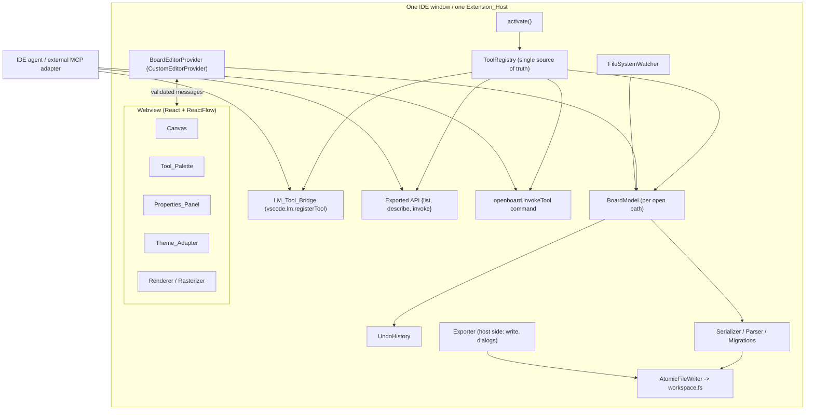
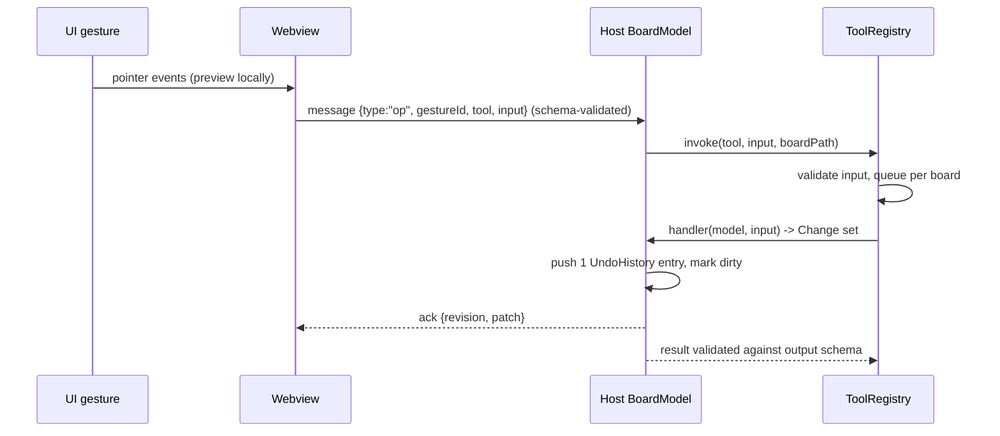

# Design Document

## Overview

OpenBoard is a VS Code / Open VSX extension that provides an infinite whiteboard, flow chart, and mockup editor for `.openboard` files. It is built from three layers:

1. **Core (pure TypeScript, no `vscode` or DOM imports):** the Board_Document model, schema, Serializer/Parser, migrations, command/operation engine, undo history, Tool_Registry, layout, Mermaid import, geometry, and ID generation. This layer is deterministic and is where nearly all property-based tests run.
2. **Extension host (Node, `vscode` API):** `CustomEditorProvider`, document lifecycle, file I/O, LM_Tool_Bridge, exported API, `openboard.invokeTool` command, settings, commands, trust handling.
3. **Webview (React + ReactFlow):** the Canvas, Tool_Palette, Properties_Panel, Theme_Adapter, and the Exporter's rasterizing code. The webview holds a replica of the document and sends validated operations to the host.

Key decisions:

- **One operation pipeline.** Every edit, from the UI or an agent, is an `Operation` validated and applied by the Tool_Registry handlers inside the host-owned `BoardModel`. The UI does not mutate the document directly (Req 13.12).
- **Host is the source of truth.** The Extension_Host owns the Board_Document, Undo_History, and save. The webview is a view with optimistic local preview for gestures. This is what makes webview crash recovery (Req 16.6, 16.10) and background-opened boards (Req 14.12) possible.
- **No server of any kind.** Agent exposure is: manifest-declared `languageModelTools`, the object returned from `activate()`, and the `openboard.invokeTool` command. All three call the same `ToolRegistry.invoke` (Req 13.3, 14).
- **Multi-window isolation by construction.** There is no shared mutable state outside the Extension_Host. Cross-window coordination is only through the file system and IDE file-change events (Req 15).
- **Offline and secure by default.** All assets are bundled, CSP forbids remote origins, and the extension makes no network requests (Req 1.3, 16).

### Research Summary

- **VS Code custom editors:** `CustomEditorProvider` with `CustomDocument` supports undo/redo through `onDidChangeCustomDocument` events carrying `undo`/`redo` callbacks, `backupCustomDocument` for hot exit, and `saveCustomDocument`/`saveAs`/`revert`. `supportsMultipleEditorsPerDocument: true` gives one shared document across tabs (Req 2.5). Webview content retention uses `retainContextWhenHidden`, but it is memory-heavy, so the design persists viewport state in the host and restores it via `getState`/`setState` instead (Req 2.10). Source: [VS Code Custom Editor API](https://code.visualstudio.com/api/extension-guides/custom-editors).
- **Language Model Tools:** tools are declared under `contributes.languageModelTools` (name, `modelDescription`, `inputSchema`, `canBeReferencedInPrompt`, `toolReferenceName`) and registered at runtime with `vscode.lm.registerTool`. `prepareInvocation` returns `confirmationMessages` and `invocationMessage`, which is where Req 14.17 is implemented. Source: [Language Model Tool API](https://code.visualstudio.com/api/extension-guides/ai/tools).
- **Workspace trust:** `capabilities.untrustedWorkspaces` in the manifest with `supported: "limited"` and a description (Req 16.8). Source: [Workspace Trust extension guide](https://code.visualstudio.com/api/extension-guides/workspace-trust).
- **ReactFlow (`@xyflow/react`):** provides pan/zoom viewport, `MiniMap`, `Background`, custom nodes/edges, `onlyRenderVisibleElements`, `minZoom`/`maxZoom`, and `NodeResizer`. We use it for the viewport, hit-testing, connections, and virtualization, and keep our own document model as the source of truth, projected into ReactFlow nodes/edges. Source: [React Flow docs](https://reactflow.dev/learn).
- **Auto layout:** a layered (Sugiyama-style) layout, implemented with the `dagre` algorithm family or `elkjs`. `dagre` is small, has no network use, supports `rankdir` TB/BT/LR/RL, and is adequate. Cycles are broken by reversing back edges, which matches the "except Edges that close a cycle" clause (Req 8.8). Source: [Dagre wiki](https://github.com/dagrejs/dagre/wiki).
- **Mermaid import:** we implement a small, purpose-built flowchart parser (graph/flowchart directive, node shapes, `-->`/`---`/`-.->`/`==>` links, `|label|` and `-- label -->` forms) rather than bundling the full `mermaid` package, which is large and needs a DOM. Errors carry line numbers (Req 8.12).
- **JSON Schema validation:** `ajv` (draft 2020-12 or draft-07) compiled at build time to standalone validators so there is no runtime `eval`, which is compatible with strict CSP and with web extension hosts. Tool input/output schemas and the Board_File schema are all JSON Schema, so one validator technology is used for everything. Source: [Ajv standalone](https://ajv.js.org/standalone.html).
- **Property-based testing:** `fast-check` for TypeScript. Source: [fast-check docs](https://fast-check.dev/).
- **Stable serialization:** canonical JSON with recursively sorted keys; arrays keep their stored order (z-order for Elements).
- **IDs:** `crypto.randomUUID()` (128-bit random, v4) gives uncoordinated cross-window uniqueness; 1,000,000 IDs have a collision probability on the order of 10^-26.
- **Atomic writes:** `vscode.workspace.fs` has no rename-over-existing guarantee on all providers, so the writer does write temp, then `workspace.fs.rename(tmp, target, { overwrite: true })`, and deletes the temp on failure (Req 15.10, 15.11).
- **PDF export:** a minimal embedded PDF writer (single page per export region, raster or vector paths) to stay offline and dependency-light; `pdf-lib` is the fallback choice if the minimal writer proves insufficient.
- **PNG metadata embedding:** a custom ancillary `iTXt` chunk with keyword `openboard` containing the compressed document JSON (Req 12.8). Chunk read/write is pure byte manipulation and is property-testable.

Content from external sources was paraphrased for licensing compliance.

### Reference Machine (Test Plan)

All performance targets (Req 1.7, 3.13, 17.1, 17.3, 17.4) are evaluated on this reference machine, which the requirements refer to as "defined in the test plan":

| Attribute | Value |
|---|---|
| CPU | 4 cores, x86-64 or arm64, ~3.0 GHz base (e.g., Apple M1 or Intel Core i5-class) |
| Memory | 8 GB RAM |
| GPU | Integrated, hardware acceleration enabled in Chromium |
| Display | 1920x1080 at 1x device pixel ratio; webview viewport at least 1200x800 |
| OS | Windows 11, macOS 13+, or Ubuntu 22.04 (measured on each; the lowest result must pass) |
| IDE | Minimum supported VS Code version, plus latest stable, with no other extensions installed |
| Storage | SSD |
| Network | Disabled (airplane mode) |

Measurement method:

- **Activation (1.7):** time from `activate()` entry to its promise resolving, median of 10 cold starts.
- **Open time (2.1, 17.1):** from `openCustomDocument` to the first `requestAnimationFrame` after ReactFlow reports `onInit` with all in-viewport nodes mounted; median of 5 runs, using generated fixtures (1 MB to 5 MB; 5,000 Elements).
- **FPS (3.13, 17.3):** average of frames per second from `requestAnimationFrame` timestamps over a 10-second scripted pan/zoom (1,000 Elements) and over a scripted drag (200 Elements). The harness drives synthetic pointer/wheel events through the DOM.
- **Batch (17.4):** wall time of `openboard.batch` creating 1,000 Elements, median of 5 runs.

Perf tests live in a separate `perf` suite, run on the reference machine class in CI (self-hosted or pinned runner) and tracked as trends. Perf tests are not property tests.

## Architecture



### Layering and package layout

```
src/
  core/            pure TS, no vscode/DOM
    model/         types, ids, geometry, z-order
    schema/        board.schema.json, element schemas, ajv standalone output
    format/        serializer, parser, migrations, canonical JSON
    ops/           operation types, apply/invert, undo history
    tools/         tool definitions, registry, batch, filters
    layout/        auto layout
    mermaid/       flowchart parser
    export/        scope selection, size/limit math, png-chunk, svg builder
  host/            vscode API glue
    editor/        BoardEditorProvider, BoardDocument, backups
    agent/         LM bridge, api object, invokeTool command
    io/            AtomicFileWriter, watcher, trust gate
    settings/      configuration reader/validator
  webview/         React app (bundled with esbuild)
    canvas/ palette/ properties/ theme/ render/
  shared/          message schema shared by host and webview
```

Core code is also usable in a web extension host, because it has no Node-only imports.

### Operation pipeline



Pointer-driven gestures (drag, resize, freehand) stream previews locally in the webview and send one `op` on pointer-up, so each gesture yields exactly one Undo_History entry (Req 10.5, 9.2).

### Concurrency

Each `BoardModel` has a promise-chain mutex (`serialQueue`). Tool invocations targeting the same board are enqueued and run in arrival order, each seeing the previous result (Req 14.16). Different boards run independently.

### Agent exposure without a server (Req 14)

- **Manifest:** `package.json` `contributes.languageModelTools` is generated at build time from the Tool_Registry definitions (`scripts/gen-manifest.ts`). A build-time test asserts the manifest names equal the registry names (Req 13.3, 14.2).
- **LM_Tool_Bridge:** on activation it loops over `registry.list()` and calls `vscode.lm.registerTool(name, { invoke, prepareInvocation })`. No per-tool code (Req 13.13). If `vscode.lm?.registerTool` is absent, it skips registration and logs once (Req 1.4).
- **Exported API:** `activate()` returns `{ list(), describe(name), invoke(name, input) }` and nothing else (Req 14.3).
- **Command:** `openboard.invokeTool(name, input)` accepts an object or a JSON string; unknown name or unparsable JSON throws an error naming the invalid argument (Req 14.4, 14.5). The `openboard.invokeTool` command is an internal command and is not counted among the six Command Palette commands (Req 18.1): it is registered with `commands.registerCommand` but omitted from `contributes.commands` and from the palette.
- **No server:** no `net`, `http`, `ws`, or named pipes are imported. A lint rule (`no-restricted-imports`) and a runtime test (Req 19.6) enforce this. No lock or port files are written (Req 14.7, 15.7).
- **Documentation:** the README includes a section stating that an external MCP adapter may call the exported API or `openboard.invokeTool` (Req 14.8).

### Multi-window isolation (Req 15)

- All state (`BoardModel` map, `UndoHistory`, selection, viewport, caches) is module-scoped inside the Extension_Host and never persisted to a shared location. Persistence uses only `context.storageUri`, `context.globalStorageUri` (per-user, read only for static caches, never for runtime state), and `workspaceState`.
- Cross-window communication is exclusively the file system. When another window saves, the IDE `FileSystemWatcher` event triggers a reload or a conflict flow (see Components, `ExternalChangeHandler`).
- Save is write temp then rename, so a crash mid-save leaves the old file intact (Req 15.10).
- Element IDs are `crypto.randomUUID()` with no cross-window counter (Req 15.9).
- On `deactivate()`, the extension disposes all watchers, deletes any temp files it still owns, and clears timers (Req 15.7). Since no process, port, or lock is ever created, there is nothing global to release.
- Extension_Host crashes are isolated by VS Code per window; because we never share state, other windows are unaffected (Req 15.8).

### Theme and webview security

The webview HTML is generated by the host with a nonce-based CSP:

```
default-src 'none'; img-src ${cspSource} data: blob:; style-src ${cspSource} 'unsafe-inline'?; 
script-src 'nonce-${nonce}'; font-src ${cspSource}; connect-src 'none';
```

Styles use bundled CSS files and CSS custom properties; ReactFlow positions nodes through inline `style` attributes set via CSSOM (allowed under `style-src-attr` handling), so the CSP uses `style-src ${cspSource}` plus `style-src-attr 'unsafe-inline'` only for attributes, never for `<style>` elements or scripts. Scripts need a nonce, so inline scripts and remote origins are blocked (Req 16.1, 16.2).

## Components and Interfaces

### Core model API

```ts
type ElementId = string;           // UUID v4
type ElementType =
  | "rectangle" | "ellipse" | "diamond" | "line" | "arrow" | "freehand"
  | "text" | "image" | "frame" | "sticky" | "flowNode" | "edge";

interface BoardModel {
  readonly path: string;
  getDocument(): BoardDocument;
  apply(change: Change): void;             // internal; used only by tool handlers
  transact<T>(label: string, fn: (tx: Tx) => T): T;  // single undo entry, rolls back on throw
  history: UndoHistory;
  serialQueue: SerialQueue;
}

interface Tx {                              // the only mutation surface
  create(el: ElementInput): Element;
  update(id: ElementId, patch: Partial<Element>): void;
  remove(id: ElementId): void;              // cascades to attached edges
  reorder(ids: ElementId[], mode: ZOrderMode): void;
  setViewport(v: Viewport): void;
  addAsset(a: AssetInput): AssetId;
  // ...library, metadata
}
```

`transact` records all changes to a Change list. On success it pushes exactly one `HistoryEntry { label, forward, inverse }`. On throw it applies nothing (changes are staged on a copy-on-write draft, using structural sharing via Immer-like patches, then committed), so the document and history are unchanged (Req 10.7, 13.7).

### Operation and undo history

```ts
interface HistoryEntry { label: string; patches: Patch[]; inversePatches: Patch[]; }
class UndoHistory {
  push(e: HistoryEntry): void;   // clears redo stack, evicts oldest beyond limit (>=200; default 500)
  undo(model): boolean;          // false and no-op when empty
  redo(model): boolean;
}
```

The host `BoardDocument` (a `vscode.CustomDocument`) fires `onDidChangeCustomDocument` with `undo`/`redo` callbacks wired to `UndoHistory`, so IDE Undo/Redo commands and shortcuts route through the IDE (Req 10.10). The retained limit is configurable internally and defaults to 500, which satisfies "at least 200".

### Tool_Registry

```ts
interface ToolDefinition<I, O> {
  name: string;                 // 1..64 chars, [a-z0-9_.-]
  description: string;          // 1..1000 chars
  inputSchema: JSONSchema;
  outputSchema: JSONSchema;
  destructive?: boolean;
  writesElsewhere?: boolean;    // writes files other than the active board (trust gate)
  boardResolution: "required-or-active" | "create" | "none";
  handler(ctx: ToolContext, input: I): Promise<O> | O;
}

interface ToolRegistry {
  list(): string[];
  describe(name: string): { description: string; inputSchema: JSONSchema; outputSchema: JSONSchema };
  invoke(name: string, input: unknown): Promise<unknown>;
}
```

`invoke` pipeline:

1. Look up tool (unknown name returns an error naming the argument).
2. Validate `input` with the compiled input validator. On failure, return `{ error: { code: "invalid_input", issues: [{ path, reason }] } }` and do not call the handler (Req 13.9, 13.10).
3. Resolve board (see Board resolution below).
4. Enforce workspace trust (see below).
5. Enqueue on the board's `serialQueue`.
6. Run `handler` inside `model.transact`. On throw, nothing changes.
7. Validate the result against the output schema (a failure here is an internal error and rolls back the transaction; it should never occur if tests pass).
8. Return the result.

#### Tool catalogue

Tools are coarse and polymorphic, to keep the catalogue small for LLM use while covering all user actions (Req 13.2, 13.4, 13.5):

| Tool | Purpose |
|---|---|
| `openboard.element.create` | Create elements; `type` discriminator + type-specific props; accepts an array |
| `openboard.element.update` | Update 1..1000 elements chosen by `ids`, `type`, or property `filter` |
| `openboard.element.query` | Query with filter + pagination (1..500 per page) |
| `openboard.element.delete` | Delete 1..1000 elements (cascades edges) |
| `openboard.element.arrange` | Group/ungroup, align, distribute, z-order, duplicate, paste/copy payloads |
| `openboard.connect` | Create edges / connect nodes, with routing, arrowheads, label |
| `openboard.layout` | Auto layout with direction |
| `openboard.import` | Import Mermaid text, images (base64), components, PNG with embedded board |
| `openboard.export` | Export with format/scope/scale/padding/background; returns base64 data and MIME type or writes to a path |
| `openboard.viewport` | Set/zoom to fit/zoom to selection/pan |
| `openboard.batch` | 1..500 ordered operations, atomic |
| `openboard.schema` | Returns JSON Schema of every element type and every tool |
| `openboard.board.summary` | Board summary |
| `openboard.board.preview` | Render PNG preview of a region (base64 + MIME) |
| `openboard.board.list` / `open` / `create` / `save` / `close` | Board lifecycle |
| `openboard.library.save` / `list` / `insert` | Component library |
| `openboard.undo` / `openboard.redo` | History control |
| `openboard.selection` | Get/set selection (selection is per-window UI state held in the host session store) |
| `openboard.settings.get` | Read effective settings |

The UI maps each gesture to one of these tools (for example, the Properties_Panel emits `openboard.element.update`; the align menu emits `openboard.element.arrange`). Req 13.12 is satisfied by this shared path. A coverage table in `docs/action-coverage.md` maps each user-facing action to the tool and is checked by a test that enumerates the UI action ids (`ActionId` enum) and asserts each has a tool mapping (Req 13.2).

`openboard.batch`:

```ts
interface BatchInput { board?: string; operations: { tool: string; input: unknown }[] /* 1..500 */ }
type BatchResult =
  | { ok: true; results: unknown[]; exceededTimeTarget?: boolean }
  | { ok: false; error: { index: number; reason: string; issues?: Issue[] } };
```

All operations run in a single `transact`, so failure at index _i_ discards all (Req 13.6, 13.7). Nested `batch` is not allowed. A batch creating elements reports `exceededTimeTarget: true` if it exceeds 5 seconds but never aborts for time (Req 17.7).

#### Board resolution (Req 14.9 to 14.13, 13.16, 13.17)

```ts
function resolveBoard(tool, input): BoardModel
  if input.board given:
      path = normalize(input.board)
      if open(path): return it
      if exists(path): return openInBackground(path)    // no editor tab
      if tool.boardResolution == "create": handled by create tool
      else throw NotFound(path)                          // never creates a file
  else if activeBoardEditor(): return its model
  else throw NoActiveBoard({ openBoards: [...paths] })
```

Background-opened boards are held in the same per-window `BoardModel` map with a reference count and a "background" flag; they are released after the invocation completes unless the user has made them dirty (they then stay until saved or closed through `openboard.board.close`).

#### Workspace trust

Before step 5, if `!vscode.workspace.isTrusted` and the tool is a write tool, `writesElsewhere` tools (export to a path, create board file, save as, board open that creates) and writes to any file other than the active Board_File are rejected with `{ code: "workspace_untrusted" }` (Req 16.9). Viewing and in-memory edits of the active board are permitted. The manifest sets `untrustedWorkspaces: { supported: "limited", description: ... }` (Req 16.8).

#### LM tool confirmation (Req 14.17)

```ts
prepareInvocation(options) {
  const def = registry.def(name);
  if (!def.destructive) return { invocationMessage: `OpenBoard: ${name}` };
  const msg = truncate(`${name} on ${boardPathOrActive}: ${effectSummary(options.input)}`, 300);
  return { invocationMessage: ..., confirmationMessages: { title: name, message: msg } };
}
```

`destructive` tools: element delete, board close with discard, undo, batch containing any destructive operation, any tool that overwrites a file. `truncate` guarantees ≤ 300 characters and keeps the tool name, board path, and effect prefix by shortening the path from the left with an ellipsis if needed.

### Serializer, Parser, Migrations

```ts
function serialize(doc: BoardDocument): string;                       // canonical UTF-8 JSON
function parse(text: string): ParseResult;                            // ok | error
type ParseResult =
  | { ok: true; doc: BoardDocument; readOnly: boolean; migratedFrom?: number }
  | { ok: false; kind: "json"; line: number; column: number; message: string }
  | { ok: false; kind: "schema"; path: string; message: string };
```

- `serialize` emits keys sorted alphabetically at every object level (including unknown preserved properties), two-space indentation, `\n` line endings, and a trailing newline. Elements are emitted in stored z-order. Assets are deduplicated by content hash (SHA-256 of bytes) and emitted only if referenced by at least one Element (Req 7.10, 7.11).
- `parse` handles: empty or zero-byte input returns an empty doc (Req 11.12); JSON syntax errors convert the `JSON.parse` error position to 1-based line and column (Req 11.7); schema errors report the JSON-pointer path of the first offending property (Req 11.8); `schemaVersion` lower than current runs migrations `v(n) -> v(n+1)` in order (Req 11.9); higher than current returns `readOnly: true` and the raw text is retained for display (Req 11.10); unknown properties are stored in an `extra` bag at every level and re-emitted (Req 11.11).
- Files above 200 MB are rejected by the host before reading, using `workspace.fs.stat` (Req 16.7). Files above 5,000 elements show a notice (Req 17.6).

### BoardEditorProvider (host)

Implements `CustomEditorProvider<BoardDocument>` with `supportsMultipleEditorsPerDocument: true`. Responsibilities:

- `openCustomDocument`: stat size check; read via `workspace.fs`; parse; create `BoardModel` (or reuse one already opened in background); on parse error create an "invalid" document, and the webview shows the error panel with an "Open as text" action and no Canvas (Req 2.9, 11.7).
- `resolveCustomEditor`: sets webview options (`enableScripts`, `localResourceRoots` restricted to the extension's `dist`), HTML with CSP, and attaches a `WebviewSession`.
- Dirty tracking: each applied history entry fires `onDidChangeCustomDocument` immediately (well within 500 ms, Req 2.3). Save clears dirty.
- `saveCustomDocument`: `AtomicFileWriter.write(uri, bytes)`. `saveCustomDocumentAs`, `revertCustomDocument`, `backupCustomDocument` (writes serialized content to the backup URI for hot exit, Req 11.14).
- Auto-save and Save As are provided by the IDE through the custom editor contract (Req 11.13).
- Viewport persistence on hide: the webview posts viewport updates (debounced) to the host session; on `onDidChangeViewState` visible, the host re-sends the stored viewport (Req 2.10).
- Multi-tab sync: edits go through the model, which broadcasts a `patch` message to all sessions of that document, each of which applies it within one message hop (Req 2.5).

### AtomicFileWriter

```ts
async function write(uri: Uri, bytes: Uint8Array) {
  const tmp = uri.with({ path: `${uri.path}.${randomUUID()}.tmp` });
  try {
    await fs.writeFile(tmp, bytes);
    await fs.rename(tmp, uri, { overwrite: true });
  } catch (e) {
    await fs.delete(tmp).catch(() => {});   // best effort
    throw new SaveFailed(e);                // caller shows error, keeps dirty
  }
}
```

The caller catches `SaveFailed`, shows an error message, and keeps the document dirty with all in-memory content (Req 11.16, 15.11). `OpenBoard` registers the temp pattern `*.openboard.*.tmp` with `files.exclude` only through documentation, never by writing user settings.

### ExternalChangeHandler (Req 2.7, 2.8, 15.4 to 15.6)

On `FileSystemWatcher.onDidChange(uri)`:

1. Ignore events caused by our own write (compare the post-write mtime/size and a content hash recorded by the writer).
2. If the model is not dirty: read, parse, replace the model content, preserve the viewport, send a `reset` message (within 2 s).
3. If dirty and the document is the `2.8` case: keep edits and show a notification. For the multi-window case (`15.6`), show a conflict prompt with exactly three choices: "Keep local", "Load disk version", "Compare as JSON text" (opens a diff via `vscode.diff` between a virtual document of the local serialization and the disk file). The local document is unchanged until a choice is made. The single notification of 2.8 is satisfied by the same prompt, whose message states that the file changed on disk.

### Webview components

- **Canvas** (`@xyflow/react`): nodes and edges are projected from the document by `toReactFlow(doc, viewportBounds)`; `onlyRenderVisibleElements` is enabled and an additional `visibleSet` function filters Elements to those whose bounds intersect the viewport expanded by 256 px (Req 17.2). `minZoom=0.02`, `maxZoom=8`. Zoom-around-pointer is the ReactFlow default behavior, verified by test. A custom `ElementNode` renders each Element type via SVG; freehand strokes render via `perfect-freehand`-style path generation implemented in core (`strokePath`).
- **Tool_Palette:** a roving-tabindex toolbar with 13 tools, an exclusive `activeTool` state, shortcut table, and `aria-label`s that are unique (Req 5.14).
- **Properties_Panel:** a form generated from a property descriptor table (`PROPERTY_DESCRIPTORS`) that defines range, type, and precision per property; validation uses the same `validateProperty` function as the tool schemas (Req 6.7, 9.8).
- **Theme_Adapter:** reads `--vscode-*` variables via `getComputedStyle`, maps them to a `ThemePalette`, listens to `MutationObserver` on `body` class (`vscode-light`, `vscode-dark`, `vscode-high-contrast`, `vscode-high-contrast-light`) and style changes, and updates CSS variables within one frame. Elements with `color: "theme:default"` are resolved at render time, so no document mutation occurs on theme change (Req 4.5). Missing variables fall back to built-in defaults per theme kind (Req 4.9). The default stroke and text colors are chosen from a candidate list by a `pickContrastColor(bg)` function ensuring at least 4.5:1 (Req 4.4).
- **Renderer/Rasterizer:** a single `renderToSvg(doc, scope, options)` function in core produces SVG; the webview rasterizes SVG to PNG/JPEG/WebP via an offscreen canvas (`Image` from a `blob:` URL, `canvas.toBlob`). The same SVG renderer feeds the live Canvas element renderers, which is what keeps export within 1 px of the canvas (Req 12.14). Text layout is measured by the same function in both paths.
- **Sanitizer:** rich text is stored as a restricted run model (`{text, bold, italic, underline}[]`), not HTML, so there is nothing to sanitize beyond escaping; imported HTML is converted to runs by a whitelist (Req 16.3, 6.11). SVG Assets are rendered through ``, which disables script execution and external loads (Req 16.4, 7.2).

### Webview/Host message protocol

All messages are JSON objects with `type` and are validated on receipt with a compiled schema in `shared/messages.schema.json` (Req 16.5). Invalid messages are dropped and logged to the "OpenBoard" output channel.

```ts
type WebviewToHost =
  | { type: "ready" }
  | { type: "op"; gestureId: string; tool: string; input: unknown }
  | { type: "viewport"; viewport: Viewport }
  | { type: "selection"; ids: ElementId[] }
  | { type: "export:result"; requestId: string; bytes: string /* base64 */; mime: string }
  | { type: "render:result"; requestId: string; png: string }
  | { type: "log"; level: "info"|"warn"; message: string };

type HostToWebview =
  | { type: "init"; doc: SerializedBoard; settings: Settings; readOnly: boolean }
  | { type: "ack"; gestureId: string; revision: number; patches: Patch[] }
  | { type: "patch"; revision: number; patches: Patch[] }
  | { type: "reset"; doc: SerializedBoard }
  | { type: "settings"; settings: Settings }
  | { type: "render:request"; requestId: string; spec: RenderSpec }
  | { type: "notice"; level: string; message: string };
```

Each `op` carries a `gestureId`; the host holds a `pending` map. If the webview terminates (`onDidDispose`/`render process gone`) with unacknowledged gestures, the host keeps the last acknowledged model state (the model is only changed on successful apply, so this holds naturally) and shows a notification (Req 16.10). On webview restart, the host re-sends `init` (Req 16.6, within 5 s; a watchdog pings the webview every 2 s and recreates the content on missed pongs).

Rendering requests (`board.preview`, `export`, `Copy as PNG`) are sent to a live webview session. If no editor is displayed for the board (background-opened), the host creates a hidden `WebviewPanel` for rendering (disposed after use) so that the same renderer produces the output. Agent previews and exports therefore always use the same rasterizer.

### Exporter

```ts
interface ExportOptions {
  format: "png" | "svg" | "jpeg" | "webp" | "pdf";
  scope: { kind: "board" } | { kind: "selection"; ids: ElementId[] } | { kind: "frame"; id: ElementId } | { kind: "allFrames" };
  scale: 1 | 2 | 3 | 4;
  padding: number;            // integer 0..256
  background: "transparent" | "white" | "theme";   // transparent only for png/webp
  matchTheme: boolean;
  embedBoard?: boolean;       // png only
}
```

Core pure functions:

- `selectScope(doc, scope): Element[]` returns Elements whose bounds intersect the scope region (Frame bounds, or the selected elements). For a Frame, the Frame's children and any Element whose bounds intersect the Frame are included (Req 12.15).
- `computeOutputSize(bounds, padding, scale): {w, h}` and `checkLimits(...)` return errors for empty scope (Req 12.12) and for output over 16,384 px on either side (Req 12.13).
- `validatePadding(x)`: accepts integers 0..256 only.
- `buildSvg(...)`: self-contained SVG, with Assets inlined as data URIs (Req 12.7).
- `embedBoardInPng(png, boardJson)` and `extractBoardFromPng(png)`: PNG chunk read/write.
- Transparent export: the raster background is not filled, leaving alpha 0 where no Element paints.

Host side: shows `showSaveDialog`, writes to a temp file and renames (atomic writer), and on cancellation or failure ensures no partial output remains (Req 12.9, 12.10). "Copy as PNG" is sent to the webview, which calls `navigator.clipboard.write`; failures post a `notice` (Req 12.11). The all-Frames scope asks for a folder and writes one file per Frame, with names made unique by index.

### Layout and Mermaid

- `autoLayout(nodes, edges, direction): Map<ElementId, Point>`: runs layered layout over the selected Flow_Nodes and edges between them. Node sizes come from their bounds; the result is anchored so the selection's top-left stays in place. The result is applied through one `transact` (Req 8.9). Fewer than two nodes returns a `{ code: "too_few_nodes" }` error and a UI message (Req 8.10).
- `parseMermaid(text): { nodes, links } | { error: { line, message } }`: tokenizes line by line and supports `flowchart|graph` with `TD|TB|BT|LR|RL`, node shapes `[ ] ( ) ([ ]) { } [( )] [[ ]] >]`, link forms with optional labels. Shape maps to one of the seven Flow_Node presets. Direction of the import also seeds an initial auto layout (Req 8.11, 8.12).

### Settings

`ConfigReader` reads `openboard.*` via `workspace.getConfiguration`, validates each value with a descriptor table, and falls back to the default for invalid values without writing back (Req 18.5). `onDidChangeConfiguration` pushes a `settings` message to all sessions (Req 18.4). Localization uses `package.nls.json` for manifest strings and `vscode.l10n.t` for runtime strings, with English as the fallback (Req 18.9).

### Commands, menus, packaging

- Six palette commands: `openboard.newBoard`, `openboard.export`, `openboard.zoomToFit`, `openboard.toggleGrid`, `openboard.toggleMinimap`, `openboard.openAsText`. Commands needing an active editor display a notification when none is active (Req 18.2).
- Explorer context menu: `openboard.newFileInFolder` with `when: explorerResourceIsFolder`, and `openboard.exportFile` with `when: resourceExtname == .openboard`. These are menu-only commands hidden from the palette through `commandPalette` `when: false` entries (so the palette keeps exactly six, Req 18.1).
- `contributes.languages` registers the `openboard` language id, extension `.openboard`, and an icon; `contributes.jsonValidation` registers the Board_File JSON Schema for `*.openboard` (Req 11.15, 18.8).
- Engine: `"vscode": "^1.95.0"` (the first version that stabilized the LM tool API surface used here is the lower bound; the exact value is pinned in `package.json` and tested in the compatibility matrix). Also builds with `ovsx`-compatible metadata. A single `.vsix` built by `vsce package` is published to both registries (Req 1.1, 1.2). `extensionKind: ["workspace", "ui"]` with no native modules and no Node-only dependencies in core makes the extension portable across Windows, macOS, and Linux (Req 1.5).
- Activation events: `onCustomEditor:openboard.board`, `onCommand:*` for the commands, and `onLanguageModelTool:*` is implicit from manifest declaration; activation is lazy to meet the 2000 ms target by deferring ReactFlow bundle loading to the webview and compiling no schemas at runtime (validators are pre-built).

## Data Models

### Board_File (version 1)

```ts
interface BoardFile {
  schemaVersion: 1;
  meta: { id: string; title?: string; createdAt?: string; modifiedAt?: string; generator?: string };
  viewport: { x: number; y: number; zoom: number };      // zoom 0.02..8
  elements: Element[];                                    // order = z-order, back to front
  assets: Asset[];
  library: LibraryComponent[];
  settings?: { grid?: { enabled: boolean; spacing: number }; minimap?: boolean };
  // unknown top-level properties preserved
}

interface Asset { id: string; mime: "image/png"|"image/jpeg"|"image/gif"|"image/webp"|"image/svg+xml";
                  hash: string; width: number; height: number; data: string /* base64 */ }

interface LibraryComponent { id: string; name: string /* 1..100 */; elements: Element[]; builtin?: boolean }
```

`modifiedAt` is not rewritten on identical content, so saves of unchanged documents are byte-identical (Req 11.3). It changes only when an edit is applied, and it is stored in the document state, not computed at serialization.

### Element

```ts
interface ElementBase {
  id: ElementId; type: ElementType;
  x: number; y: number; width: number; height: number;    // |x|,|y| <= 1_000_000; width,height >= 1; 2 dp
  rotation: number;                                       // -360..360
  parentId?: ElementId;                                   // frame child
  locked?: boolean;
  groupId?: string;
  style: {
    fill: Color; stroke: Color; strokeWidth: number /*0..100*/; strokeStyle: "solid"|"dashed"|"dotted";
    opacity: number /*0..100*/; cornerRadius: number /*0..min(w,h)/2*/;
  };
}
type Color = "theme:default" | `#${string}`;    // explicit hex; "theme:default" resolved at render time

interface TextProps { runs: { text: string; bold?: boolean; italic?: boolean; underline?: boolean }[];
                      fontFamily: string; fontSize: number /*1..999*/; align: "left"|"center"|"right" }
interface ImageProps { assetId: string; crop?: {x:number;y:number;w:number;h:number}; alt?: string /*<=500*/ }
interface FreehandProps { points: { x: number; y: number; p?: number }[]; baseWidth: number /*1..100*/ }
interface FlowNodeProps extends TextProps { preset: "startEnd"|"process"|"decision"|"inputOutput"|"database"|"document"|"annotation" }
interface FrameProps { name: string; preset?: string }
interface EdgeProps { sourceId: ElementId; targetId: ElementId; routing: "straight"|"curved"|"orthogonal";
                      sourceArrow: ArrowHead; targetArrow: ArrowHead; label?: string /*<=200*/ }
```

Each Element has an `extra` bag (unknown properties) that the parser fills and the serializer flattens back to its original location. Edge Elements are stored in `elements` too, so they participate in z-order and in Element-ID uniqueness.

Invariants maintained by `transact` (checked in debug builds and tests):

- Element IDs unique.
- Every Edge `sourceId` and `targetId` references an existing Element.
- Every `parentId` references an existing Frame.
- Every `assetId` references an existing Asset; no unreferenced Asset remains after serialization.

### Runtime-only state (never persisted in the file)

```ts
interface Session {            // per window, per document, host-side
  selection: Set<ElementId>; viewport: Viewport; activeTool: ToolId;
  clipboard?: Element[];       // internal clipboard payload
  pendingGestures: Map<string, ...>;
}
```

### Tool schemas

Each ToolDefinition's `inputSchema`/`outputSchema` is authored in TypeScript with a small schema builder (so the TS type, JSON Schema, and fast-check arbitrary can be derived from one description), compiled by Ajv standalone at build time into `dist/validators.js`. `openboard.schema` returns these schemas plus the per-Element schemas (Req 13.8).

## Correctness Properties

A property is a characteristic or behavior that should hold true across all valid executions of a system-essentially, a formal statement about what the system should do. Properties serve as the bridge between human-readable specifications and machine-verifiable correctness guarantees.

Reflection on redundancy: the viewport math criteria (3.2, 3.3) stay separate because they constrain different functions. Clamping (3.4, 3.5) and fit (3.6, 3.8, 3.9) are kept apart because fit already depends on clamping. Undo/redo (10.2 to 10.4) merge into one history property plus one "new edit clears redo" property. Range validation for 6.6, 6.7, 6.9, 9.7, 9.8 merge into one property. Round trip (11.6), key stability (11.3, 11.4), and unknown-property preservation (11.11) stay separate because they fail in different ways, but 11.4 is subsumed by 11.6 and is not listed on its own. Atomic batch (13.6, 13.7) and tool failure (10.7) merge. Align (5.8) and distribute (5.9) remain separate.

### Property 1: Document round trip

For any valid Board_Document (0 to 500 Elements of any type, any assets, library, and viewport), `parse(serialize(doc))` yields a Board_Document equal to `doc`, with every Element keeping its identifier and rich-text styling.

**Validates: Requirements 11.5, 11.6, 11.4, 6.11**

### Property 2: Serialization is canonical and idempotent

For any valid Board_Document, `serialize(parse(serialize(doc)))` is byte-identical to `serialize(doc)`, object keys are in alphabetical order at every level, and Elements appear in their stored z-order.

**Validates: Requirements 11.1, 11.3**

### Property 3: Unknown properties are preserved

For any valid Board_Document and any set of unknown properties injected at any object level of the JSON, parsing and then serializing keeps every unknown property with its original name and value.

**Validates: Requirements 11.11**

### Property 4: Invalid JSON reports a correct position

For any serialized Board_Document corrupted so it is no longer valid JSON, `parse` returns a JSON error whose 1-based line and column lie inside the text and identify a position at or after the first corrupted character.

**Validates: Requirements 11.7**

### Property 5: Schema violations name the offending path

For any valid Board_Document with one property replaced by a value of the wrong type or outside its allowed range, `parse` returns a schema error whose path equals the JSON path of that property.

**Validates: Requirements 11.8**

### Property 6: Migration produces a current-version document

For any document at a prior Schema_Version (generated per version), migration yields a document that validates against the current schema, has the current Schema_Version, and serializes with the current version.

**Validates: Requirements 11.9**

### Property 7: Assets are stored once and only when referenced

For any Board_Document with any pattern of Elements referencing Assets (including several Elements sharing one Asset, and Assets with no referencing Element), the serialized output contains each referenced Asset exactly once and contains no unreferenced Asset.

**Validates: Requirements 7.10, 7.11**

### Property 8: Undo and redo are inverses

For any board and any sequence of 1 to 20 edits, undoing all edits and then redoing them yields the document that existed immediately before the first Undo, and undoing a single edit restores the document to its state before that edit. Undo or Redo on an empty stack leaves the document unchanged.

**Validates: Requirements 10.2, 10.3, 10.9, 19.4**

### Property 9: History bookkeeping

For any sequence of edits, undos, and redos, each edit adds exactly one history entry and marks the document modified, a new edit after an Undo empties the redo stack, and the undo stack never exceeds the configured limit (at least 200), always evicting the oldest entry first.

**Validates: Requirements 10.1, 10.4, 10.8**

### Property 10: Failed operations leave the document unchanged

For any board state and any batch of 2 to 50 operations in which exactly one operation fails, the document and history after the batch are equal to those before it, and the error reports the zero-based index of the failing operation. The same holds for any single tool invocation that throws.

**Validates: Requirements 13.6, 13.7, 10.7, 19.3**

### Property 11: Successful tool invocation is one history entry

For any valid tool input that succeeds, the invocation records all its changes as exactly one history entry, and the result validates against the tool's output schema.

**Validates: Requirements 10.6, 13.11**

### Property 12: Invalid input is rejected before the handler runs

For any tool and any input that violates its input schema, the handler is not called, the error lists every invalid property path with a reason, and the document is unchanged.

**Validates: Requirements 13.9, 13.10, 19.2**

### Property 13: Tool schemas accept valid and reject invalid samples

For any tool, generated valid inputs and outputs are accepted by its schemas, and generated invalid inputs and outputs are rejected.

**Validates: Requirements 19.2, 13.1**

### Property 14: Tool definitions satisfy size limits

For any tool in the registry, the name has 1 to 64 characters, the description has 1 to 1,000 characters, and input and output schemas are present. All names are unique.

**Validates: Requirements 13.1**

### Property 15: One registry feeds all three exposure paths

For any registry content, the names listed by the LM_Tool_Bridge, the exported API `list`, and the command-driven path are the same set, and `describe` returns the registry's description and input schema for each.

**Validates: Requirements 13.3, 13.13, 14.2, 14.3**

### Property 16: UI and agent edits are equivalent

For any board and any valid edit expressed as a tool input, applying it through the UI action path and through the agent invoke path yields equal Board_Documents.

**Validates: Requirements 13.12**

### Property 17: Filtered selection matches the filter

For any board and any selector (ids, type, or property filter), the elements affected by update, query, or delete are exactly those matching the selector, and only those, up to the 1,000-element limit. Paging a query with any page size from 1 to 500 and concatenating the pages yields the full match list without duplicates.

**Validates: Requirements 13.5, 13.14**

### Property 18: Missing references leave the document unchanged

For any tool invocation referencing an element id, board, or path that does not exist, the error identifies the missing reference, the document is unchanged, and no file is created.

**Validates: Requirements 13.17, 14.13**

### Property 19: Board resolution

For any combination of (path given or omitted, path open, path exists on disk, active editor present, tool is create), `resolveBoard` returns the open board for an open path, opens an existing unopened path in the background, returns the active board when the path is omitted, returns a not-found error for a missing path on a non-create tool, and returns a no-active-board error that lists all open board paths when nothing is active.

**Validates: Requirements 14.9, 14.10, 14.11, 14.12, 14.13**

### Property 20: Serial execution per board

For any set of tool invocations submitted concurrently to one board, the final document equals the result of running them sequentially in submission order, and each invocation observes the result of the previous one.

**Validates: Requirements 14.16**

### Property 21: invokeTool argument validation

For any tool name not in the registry, or any input string that is not valid JSON, `openboard.invokeTool` returns an error identifying the invalid argument and no document changes.

**Validates: Requirements 14.5**

### Property 22: Destructive confirmation messages

For any destructive tool, any board path, and any input, the confirmation message has at most 300 characters and contains the tool name, the (possibly shortened) target board path, and an effect description.

**Validates: Requirements 14.17**

### Property 23: Workspace trust gate

For any tool invocation in an untrusted workspace, the gate rejects the invocation with a trust error if and only if the tool would write to a file other than the active Board_File; viewing and in-memory edits of the active board are permitted.

**Validates: Requirements 16.9**

### Property 24: Invalid host/webview messages are discarded

For any message that does not match the message schema, the host discards it, the document is unchanged, and the rejection is logged.

**Validates: Requirements 16.5**

### Property 25: Text content is sanitized

For any text or rich-text input, including strings containing script tags, event-handler attributes, and `javascript:` URLs, the sanitized or rendered output contains no executable script, no `on*` attribute, and no `javascript:` URL.

**Validates: Requirements 16.3**

### Property 26: Element identifiers do not collide

For any number of identifiers generated by any number of simulated windows without coordination, all identifiers are distinct, and every document ID set is unique.

**Validates: Requirements 15.9, 11.4**

### Property 27: Atomic writes survive any failure

For any file content and any injected failure point (temp write, rename), the target file is byte-identical to its pre-save content, the temp file is removed, and the caller receives a failure result that keeps the document dirty. For a successful write, the target equals the new content and no temp file remains.

**Validates: Requirements 15.10, 15.11, 11.16**

### Property 28: Zoom is clamped

For any current zoom, any zoom factor, and any viewport center, the resulting zoom lies in [2%, 800%], the viewport center is unchanged when clamping occurs, and clamping is idempotent.

**Validates: Requirements 3.4, 3.5**

### Property 29: Zoom keeps the pointer point fixed

For any viewport, any pointer position, and any zoom step that does not hit a limit, the board point under the pointer maps to the same screen position (within 1 pixel) before and after the zoom.

**Validates: Requirements 3.2**

### Property 30: Pan follows the drag

For any viewport and any drag vector, the viewport offset changes by the drag vector within 1 pixel, in the same direction.

**Validates: Requirements 3.3**

### Property 31: Fit viewport contains all content

For any non-empty set of bounds within the coordinate range and any viewport size, the "Zoom to Fit" and "Zoom to Selection" result shows all target bounds with at least 32 px margin on each side at the highest zoom within [2%, 800%] that satisfies this. If even 2% cannot fit the content, the zoom is 2% and the viewport is centered on the combined bounds. For an empty set the viewport is unchanged.

**Validates: Requirements 3.6, 3.7, 3.8, 3.9, 3.10**

### Property 32: Grid snapping

For any element position and any grid spacing from 4 to 200, snapping returns a multiple of the spacing that is the nearest such multiple (ties allowed in either direction).

**Validates: Requirements 3.11**

### Property 33: Alignment snapping

For any dragged element and any set of other elements, if an edge or center is within 8 screen pixels of another's edge or center, the snapped position makes them coincide and reports a guide; otherwise the position is unchanged and no guide is reported.

**Validates: Requirements 5.11**

### Property 34: Marquee selection

For any board and any marquee, the new selection is exactly the unlocked elements whose bounds intersect the marquee by at least 1 pixel, and with Shift held it is the union with the previous selection.

**Validates: Requirements 5.4**

### Property 35: Selection-required operations

For any board with an empty selection, copy, cut, duplicate, delete, group, and ungroup leave the document unchanged and add no history entry; the same holds for paste with an empty clipboard and group with fewer than 2 elements. For any non-empty selection, each operation is undone by exactly one Undo.

**Validates: Requirements 5.6, 5.7**

### Property 36: Align

For any 2 or more elements and any align mode, after aligning every element's corresponding edge or center equals that of the original selection bounds, and sizes are unchanged.

**Validates: Requirements 5.8**

### Property 37: Distribute

For any 3 or more elements and either axis, after distributing the gaps between adjacent elements along that axis are equal (within 0.01 units), and the two outermost elements keep their positions.

**Validates: Requirements 5.9**

### Property 38: Z-order operations

For any element order and any selection, each z-order operation produces a permutation of the same elements, preserves the relative order of the selected elements, and for forward and backward moves each selected element by exactly one position unless blocked at an end.

**Validates: Requirements 5.10**

### Property 39: Keyboard nudge

For any selection and any arrow key, the selected elements move by 1 unit (10 with Shift) in that direction and unselected elements are unchanged.

**Validates: Requirements 5.13**

### Property 40: Shape creation from a drag

For any drag region whose width and height are at least 4 canvas units, the created shape's bounds equal the region within 1 unit. For any smaller drag, the shape is 100 by 100 units centered on the release point.

**Validates: Requirements 6.1, 6.2**

### Property 41: Property validation

For any property and any candidate value, the value is accepted if and only if it lies in the property's allowed range and type (including stroke width 0 to 100, opacity 0 to 100, font size 1 to 999, rotation -360 to 360, corner radius 0 to half the shorter side, width and height at least 1, freehand width 1 to 100); a rejected value leaves the document unchanged.

**Validates: Requirements 6.6, 6.7, 6.9, 9.7, 9.8**

### Property 42: Mixed property display and bulk apply

For any selection, a property is shown as mixed if and only if the selected elements have at least two distinct values, and applying a new value sets it on every selected element.

**Validates: Requirements 6.8**

### Property 43: Aspect-ratio resize

For any element and any Shift resize, the resulting width/height ratio is within 1 percent of the original ratio.

**Validates: Requirements 6.10**

### Property 44: Frame children move with the frame

For any frame and elements fully inside its bounds, creating the frame makes each such element a child, and moving the frame by any offset moves all its children by the same offset.

**Validates: Requirements 6.12**

### Property 45: Component library names

For any selection and any name, saving a component succeeds if and only if the name has 1 to 100 characters and the selection is non-empty; on success the library contains it, on rejection the library is unchanged.

**Validates: Requirements 6.15, 6.16**

### Property 46: Image validation

For any file with any detected content type and any size, the file is accepted if and only if its type is PNG, JPEG, GIF, WebP, or SVG and its size is at most 26,214,400 bytes; an exact 25 MB file is accepted; a rejected file leaves the board unchanged. For a batch of files each file is judged independently.

**Validates: Requirements 7.2, 7.3, 7.4, 7.7**

### Property 47: Image sizing

For any natural image dimensions, the created Element has the natural size if the longer side is at most 1,024, otherwise the longer side is exactly 1,024 and the aspect ratio is preserved. Replacing the source keeps x, y, rotation, and width and sets height from the new aspect ratio.

**Validates: Requirements 7.5, 7.9**

### Property 48: Edge re-routing keeps endpoints attached

For any board with edges and any move of an element, every edge attached to the moved element ends at that element's anchor in its new position.

**Validates: Requirements 8.4**

### Property 49: Deleting elements cascades to edges

For any board and any element deleted, no edge refers to a missing element afterward, and one Undo restores the element and all its edges.

**Validates: Requirements 8.6**

### Property 50: Auto layout

For any set of 2 or more Flow_Nodes, any edges among them, and any of the four directions, the layout has no overlapping node bounds and every edge not closing a cycle points in the chosen direction; one Undo restores all original positions. With fewer than two nodes, positions are unchanged.

**Validates: Requirements 8.8, 8.9, 8.10**

### Property 51: Mermaid import round trip and errors

For any generated flowchart graph (nodes with labels, links with labels and direction), printing it as Mermaid text and parsing it yields one node per node and one edge per link with the same labels and direction. For any text with a syntax error, the parser reports the line number of the first error, and no elements are created.

**Validates: Requirements 8.11, 8.12**

### Property 52: Pressure width and smoothing

For any freehand stroke with pressure values, the rendered width is between 25 percent and 200 percent of the base width and proportional to the pressure, and the smoothed path deviates by no more than 2 screen pixels from the input path.

**Validates: Requirements 9.4, 9.5**

### Property 53: Eraser removes exactly intersected elements

For any board and any pointer path, the eraser deletes exactly the elements whose rendered bounds intersect the path, in one undoable action.

**Validates: Requirements 9.6**

### Property 54: Shift-constrained strokes

For any press point and pointer position, the constrained line runs from the press point at an angle that is a multiple of 15 degrees and is the nearest such multiple.

**Validates: Requirements 9.9**

### Property 55: Theme colors

For any background color, the chosen default stroke and text colors have a contrast ratio of at least 4.5:1 against it. For any palette with any subset of CSS variables missing or empty, resolution returns the built-in default for each missing variable and never fails. For any board, switching theme kind changes the resolved color of exactly the elements using the theme default, and no explicitly colored element.

**Validates: Requirements 4.4, 4.5, 4.9**

### Property 56: Export scope

For any board and any scope (selection, frame, all frames, board), the exported elements are exactly those whose bounds intersect the scope region, and the all-Frames scope produces one output per Frame.

**Validates: Requirements 12.2, 12.15**

### Property 57: Export options and limits

For any padding value, it is accepted if and only if it is an integer from 0 to 256. For any content bounds, padding, and scale from 1 to 4, the output size equals (bounds + 2 times padding) times scale, and the export is rejected if and only if either side exceeds 16,384 pixels or the scope is empty.

**Validates: Requirements 12.5, 12.6, 12.12, 12.13**

### Property 58: SVG export is self-contained

For any board with image Assets, the exported SVG contains each used Asset as an inline data URI and contains no reference to an external resource.

**Validates: Requirements 12.7**

### Property 59: PNG metadata round trip

For any valid PNG and any Board_Document, embedding the document in the PNG and extracting it yields an equal document, and the image pixels are unchanged.

**Validates: Requirements 12.8**

### Property 60: Viewport culling

For any board and viewport, the set of rendered elements is exactly those whose bounding boxes intersect the viewport expanded by 256 pixels on each side.

**Validates: Requirements 17.2**

### Property 61: Settings fall back to defaults

For any setting and any value, a value within the allowed values or range is used as is; any other value yields the default, and the stored user value is not modified.

**Validates: Requirements 18.3, 18.5**

### Property 62: Multi-tab replicas converge

For any sequence of edits made through any tab, every replica of the shared document, after applying the broadcast patches in order, equals the host model.

**Validates: Requirements 2.5**

## Error Handling

| Situation | Behavior |
|---|---|
| File over 200 MB | Not opened; message with limit and actual size; file untouched (16.7) |
| Zero-byte file | Empty board at current version (11.12) |
| Invalid JSON | Error panel with line and column, "Open as Text" action; no Canvas; disk unmodified (2.9, 11.7) |
| Schema violation | Error panel with property path (11.8) |
| Newer Schema_Version | Read-only open; save rejected with message (11.10) |
| Save failure (write or rename) | Temp file deleted, error notification, document stays dirty, content retained (11.16, 15.11) |
| External change, clean document | Silent reload within 2 s, viewport kept (2.7, 15.5) |
| External change, dirty document | Keep local edits; conflict prompt with Keep local, Load disk, Compare (2.8, 15.6) |
| Tool input invalid | `invalid_input` error listing every path and reason; handler not run (13.10) |
| Tool failure inside transaction | Draft discarded; document and history unchanged (10.7) |
| Batch failure | `{ index, reason }`; whole batch rolled back (13.7) |
| Unknown board, element, or path | `not_found` error naming the reference; no file created (13.17, 14.13) |
| No active board and path omitted | `no_active_board` error with open board paths (14.11) |
| Untrusted workspace write | `workspace_untrusted` error (16.9) |
| Invalid webview message | Dropped; logged to output channel (16.5) |
| Webview crash | Host re-sends `init` within 5 s; unacknowledged edit reported (16.6, 16.10) |
| Missing LM Tools API | Tools not registered; everything else works (1.4) |
| Export: empty scope, over 16,384 px, cancelled dialog, write failure | No output (partial file removed), message shown (12.10, 12.12, 12.13) |
| Clipboard failure | Message shown (12.11) |
| Invalid setting | Default used; user value preserved (18.5) |
| Image rejected (type, size, decode) | Message naming the reason; board unchanged (7.3, 7.4, 7.6) |
| Mermaid parse error | Error message with first error line; no elements (8.12) |
| Missing theme variable | Built-in default for current theme kind (4.9) |
| Batch exceeds 5 s | Completes; result flags `exceededTimeTarget` (17.7) |

Errors from tools have the shape `{ code, message, index?, issues?, path?, openBoards? }`. They are returned as tool results for the LM API (as a text part flagged as error), thrown as `Error` with `code` for the exported API and command.

## Testing Strategy

**Applicability of property-based testing.** PBT applies to the Core layer (model, format, ops, tools, layout, Mermaid, geometry, export math, PNG chunks, sanitizer, settings validation). It does not apply to webview rendering and layout, packaging, manifest contributions, VS Code integration wiring, performance, or real file systems, so those use snapshot, example-based, integration, and perf tests.

### Property-based tests

- Library: `fast-check` with `vitest`. Not implemented from scratch.
- Each property test runs at least 100 iterations (`numRuns: 100`; the round trip tests for Req 19.1 use at least 100 generated documents with 0 to 500 Elements).
- Each correctness property is implemented by a single property-based test, tagged with a comment in this format: `Feature: openboard, Property {number}: {property_text}`.
- Shared arbitraries live in `test/arbitraries/`: `arbBoardDocument`, `arbElement(type)`, `arbEditSequence`, `arbToolInput(tool)` (derived from the tool schemas), `arbInvalidToolInput(tool)` (mutated valid inputs), `arbViewport`, `arbBounds`, `arbMermaidGraph`, and `arbPng`.
- Fault injection for Property 27 uses an in-memory file system double with failure hooks. Concurrency for Property 20 uses a deterministic scheduler.
- Failures print the fast-check seed and counterexample; the run exits non-zero and names each failing test (Req 19.8).

### Unit and example tests

Kept few and focused on:

- Migration fixtures for each prior Schema_Version (Req 19.7).
- Per Element type: create, update, serialize/parse, export, with equality checks (Req 19.5).
- Specific examples: seven Flow_Node presets, self-loop edge, Frame presets and built-in library, Explorer menu `when` clauses, six palette commands, manifest equals registry, localization fallback, empty-text deletion, newer-version read-only, failed save keeps document dirty.
- Action coverage: every `ActionId` in the UI maps to a tool (Req 13.2).

### Integration tests

Run with `@vscode/test-electron` (and an Open VSX-compatible host such as VSCodium where available):

- Activation, custom editor open, save, dirty state, hot exit backup, reopen with text editor.
- LM tool registration through `vscode.lm.tools`, the exported API, and `openboard.invokeTool` returning identical results.
- No sockets: after performing core operations, enumerate listening sockets of the Extension_Host process and assert there are none; also assert no lock or port files were created (Req 19.6, 14.6, 14.7).
- Two windows (two extension hosts) editing the same file: external change reload and conflict prompt; independent in-memory state (Req 15).
- Webview crash recovery using a forced webview dispose.
- Offline operation: run with network blocked and assert zero outbound requests.
- Cross-platform matrix: Windows, macOS, Linux.

### Webview and visual tests

- Component tests (React Testing Library) for Tool_Palette keyboard operation, accessible names (unique and non-empty), and Properties_Panel error indications.
- Snapshot and visual regression tests for light, dark, and high-contrast themes and for exported SVG.
- A canvas-versus-export comparison test checks that geometry and text layout differ by no more than 1 px at 1x (Req 12.14).
- Accessibility checks with `axe-core` on the toolbar and panels.

### Performance tests

Run on the reference machine class defined in the Overview (4-core CPU, 8 GB RAM, integrated GPU, 1920x1080, network disabled). Targets: activation under 2000 ms, 5 MB board opens under 2 s, 5,000-element board first frame under 3 s, at least 30 fps for 1,000-element pan/zoom and 200-element drag, 1,000-element batch under 5 s, and pointer response under 100 ms during image decode. Results are recorded per run; a regression over the target fails the perf job.

### Build-time checks

- Manifest generation test: `contributes.languageModelTools` names equal registry names.
- Lint rule forbids importing `net`, `http`, `https`, `ws`, `child_process`, and `dgram` in `src/`.
- Bundle check asserts no remote URLs in the webview bundle and CSP string contains no remote origins.
